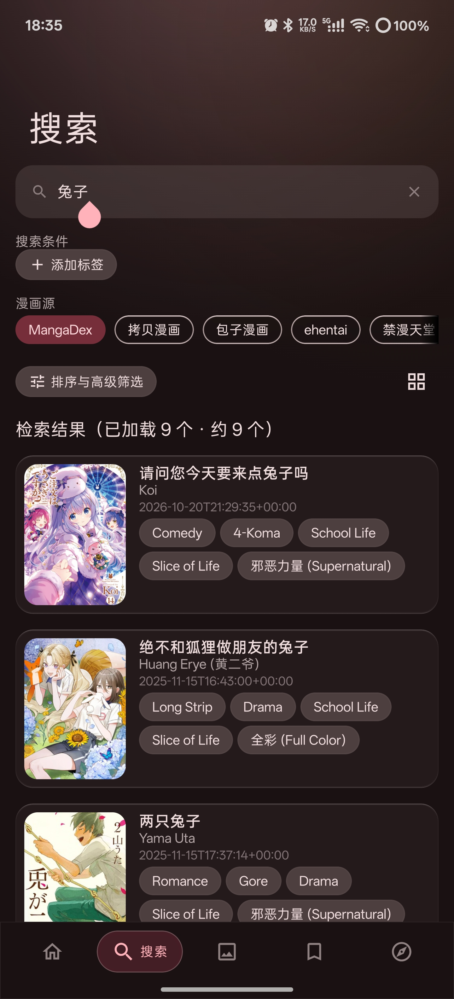
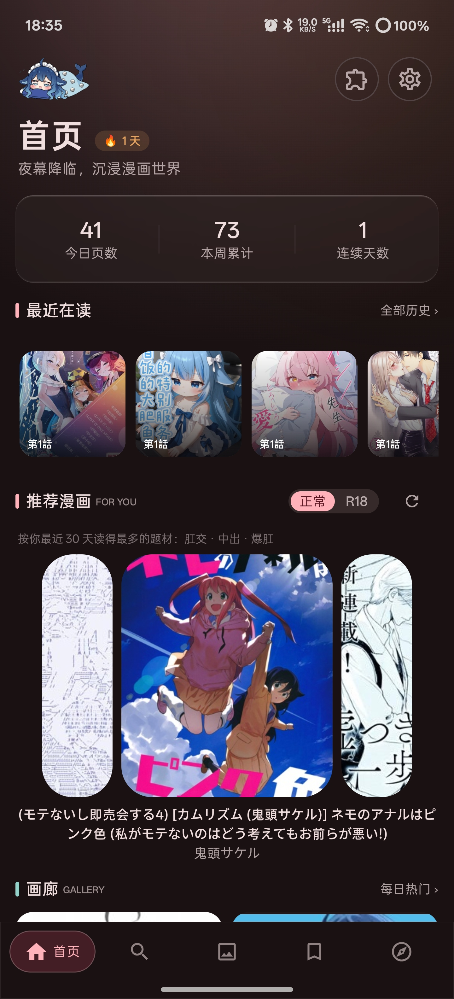
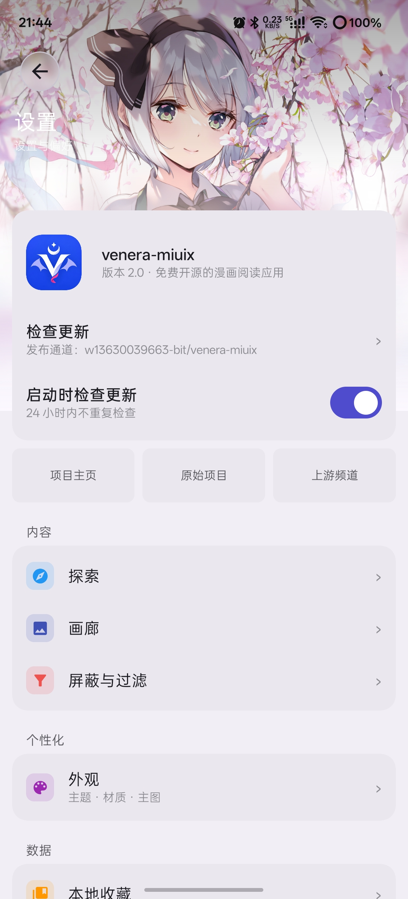

<div align="center">


# venera-miuix

**一个 Android 漫画阅读器：用 JavaScript 插件描述漫画源，聚合本地与网络漫画。**
本分支把上游 Venera 的 Flutter 实现整体换成纯原生 Kotlin + Jetpack Compose，并在这之上加了一个上游没有的画廊图站模块。

[](https://github.com/w13630039663-bit/venera-miuix/releases)
[](https://github.com/w13630039663-bit/venera-miuix/tree/compose-migration)


[](LICENSE)

**简体中文** | [English](README.en.md)

</div>

---

## 目录

- [这是什么](#这是什么)
- [界面截图](#界面截图)
- [亮点速览](#亮点速览)
- [功能总览](#功能总览)
- [与上游的区别](#与上游的区别)
- [已知缺口与明确不做](#已知缺口与明确不做)
- [下载与安装](#下载与安装)
- [从源码构建](#从源码构建)
- [架构与技术栈](#架构与技术栈)
- [项目结构](#项目结构)
- [编写漫画源](#编写漫画源)
- [贡献](#贡献)
- [致谢](#致谢)
- [许可证](#许可证)

---

## 这是什么

**Venera** 是一个优秀的第三方漫画阅读器：用 JavaScript 编写漫画源插件，聚合阅读本地与网络漫画，支持收藏、下载、评论、标签等能力。原作者已公开声明因精力有限停止维护，并欢迎 fork。

本分支（`compose-migration`）做三件事，外加一个新模块：

1. **换技术栈** —— 用 Kotlin + Jetpack Compose 全量重写，不再携带 Flutter / Dart / Rust 运行时。产物只有一个 Android 应用。
2. **换界面语言** —— 以小米 HyperOS 的 Miuix 设计体系重做全部页面，并接入官方液态玻璃库；默认界面风格是 Material 3（跟随系统壁纸取色），Miuix 作为可切换的第二风格保留。
3. **协议层不动** —— ComicSource 的 JavaScript 插件协议与官方逐字兼容，[venera-configs](https://github.com/venera-app/venera-configs) 源仓库可一键安装、一键全部更新；随包内置 34 个源脚本（33 个唯一源）做离线兜底。
4. **加一个新模块** —— 底栏第 4 位「画廊」，把 yande.re / Gelbooru / Safebooru 三个图站做成与漫画侧完全隔离的独立模块。

> **安装身份**：本分支的包名与 `master`（Flutter 版 venera-miuix）逐字一致，共用同一条发布线，按 Releases 下载时是同一个应用。Flutter 版的数据**不会自动迁移**；换机或从 Flutter 版迁过来，可以在设置里用「导入数据」读取官方 Venera 或 PicaComic 的归档，把收藏与阅读历史并进来。

- 上游原版 Venera（Flutter）：<https://github.com/venera-app/venera>
- 本仓库 `master` 分支（Flutter 版 venera-miuix）：<https://github.com/w13630039663-bit/venera-miuix>

## 界面截图

<p align="center">
  
  
  
  
  
</p>

<p align="center"><sub>首页 · 画廊 · 搜索 · 画师主页 · 设置 —— 截图中的作品封面已按分级遮罩处理，不含可辨识原图</sub></p>

## 亮点速览

**原生重写，运行时不留一层。** Flutter、Dart、Rust 全部退出依赖树，启动不再等引擎与 isolate。R8 混淆 + 资源收缩，按 ABI 出包。

**判据层下沉成纯 JVM 函数。** 内容分级判定、图片混淆分块计算、章节完整性、归档编解码、标签切分、Cookie 可注册域链这些真正决定正确性的逻辑，都不依赖 Android 框架，改一条判据会立刻红一个测试，而不是等真机点出来。

**官方源仓库直接可用。** 系统 WebView 承载源脚本，shim 层复刻原版 API 面；官方 `index.json` 支持全部更新 / 单独更新 / 自定义仓库地址 / 本地导入调试 / 可视化编辑。另有 MangaDex、拷贝漫画、包子漫画三个原生 Kotlin 源，作为 JS 引擎异常时的兜底路径。

**画廊是真隔离的模块。** 自带三层结构、自带标签词典、自带两个独立 Activity，最重要的是**独立的图片加载实例与缓存预算** —— 漫画侧那套默认配置一个字没改，画廊用独立目录与独立预算（内存 64 MB，磁盘默认 512 MB 且可调）。仍然复用的只有纯技术层：共享的连接池、Cookie、限速间隔与防盗链 UA。

**分级与屏蔽是一条判定链，不是一个开关。** 遮罩三态 + 内置 33 源分级预设 + 四类可开正则的屏蔽规则，按「用户规则 → 源预设 → 关键词兜底」的顺序推进；打码只糊封面，标题与标签照常显示。

**与上游的备份格式互通。** 本仓的 `.venera` 归档能一键导出 / 导入，同时也能直接吃官方 Venera 的 SQLite 归档与 PicaComic 的 `.picadata`，逐条合并收藏与历史 —— 来源反查靠复刻的 Dart VM 哈希函数，不要求你先导出成我们的格式。

**观感按真机像素校准。** 顶栏大标题折叠 + 磨砂圆座图标按钮、分段控制器每颗自持药丸、液态玻璃底栏、跨 Activity 系统级预测式返回、封面 → 详情的共享元素转场。尺寸口径一律取官方原值或应用内既有 token。

## 功能总览

> 下面每一条都在代码里有真实调用点。凡是「有实现但入口没接」的，一律挪到[已知缺口](#已知缺口与明确不做)，不在这里出现。

### 阅读器

- **5 种排版**：条漫纵向连续、横向连续画卷、美漫从左至右翻页（**默认**）、日漫从右至左翻页、对开双页拼合 —— 设置页与阅读器面板两处都能切。
- **前瞻预加载** 0–20 页可调，翻页不等网络。
- **自动巡航**：条漫匀速滚动（15–480 px/s）与翻页模式定时自动翻页（**1–10 秒/页**，阅读器面板上 −/+ 直接调，与设置页那条滑块是同一枚值），触摸即暂停。*画卷与双页两种模式不提供巡航。*
- **音量键翻页**（含跨章续翻）、**边缘点击翻页**（外侧 25% 区域，方向可反转，从右至左模式镜像）。
- **双指缩放**：大图由库侧自动子采样。*缩放只在左右两种翻页模式生效。*
- 章节目录抽屉、单页保存相册、单页分享、夜间柔光滤镜、屏幕常亮、页间距调节。
- 页面地址由源脚本逐页动态解析 —— 需要签名或时效地址的源才能正常出图。
- 大屏有顶栏与抽屉的宽度上限策略，不做大屏专属分页排版。

### 漫画源引擎

- 兼容官方 ComicSource JavaScript 协议，系统 WebView 承载。
- 随包内置 **34 个源脚本（33 个唯一源）** 做离线兜底；一键安装 / 全部更新 / 单独更新，支持自定义仓库地址、本地导入调试、可视化编辑与删除、源钉选与排序。
- 内置 **MangaDex / 拷贝漫画 / 包子漫画** 三个原生 Kotlin 源。
- **登录体系**：账号密码、内嵌 WebView 网页登录、Cookie 直填三种，支持状态检查、重新登录与注销。
- **聚合搜索**：单源搜索 + 「全网聚合」跨源并行，按源分组出结果；结构化标签搜索在不支持该语法的源上自动降级为客户端过滤。
- **源测速与健康度**：并行 ping，首页状态行四态（连通 / 降级 / 失败 / 未知）点击重测，源列表带耗时色标。

### 画廊（独立模块，与漫画侧完全隔离）

- **三站聚合**：yande.re + Gelbooru + Safebooru，三路并发 → 去重 → 打乱成一屏瀑布流；**每一路失败单独写明原因**，不静默把残缺页当完整结果交回。
- **每日热门** 首页预览行 + 二级整屏页（查看全部 / 换一批）；**猜你喜欢** 主墙按你的画廊收藏挑标签推荐，带种子随机、可换一批。
- **画师关注**：关注名单、圆形头像行（带收藏计数与站点图标）、画师主页独立 Activity、跨站作品聚合、**画师别名归一**（某站返回 0 张时按它自己的别名标识换正名重搜一次，非 0 张绝不替换）。*别名归一目前只接了 yande.re。*
- **反向搜图**：SauceNAO 以图搜图。*需在设置里填一把免费 API key。*
- 查看器工具栏：收藏、原图档切换、保存相册、信息面板、分享、连播（1–15 秒可调）。
- **画成水彩**（Beta，默认关）：把当前这张图按「纸 → 晕染 → 背景 → 主体 → 细节」的顺序一笔一笔画出来，可保存、可换种子重画、可与原图对照。入口在「关于这张图」面板底部那一行；Beta 关着、或这一张是视频时不摆这一格。
- **视频条目**直接播放，卡片带角标。*时长只有 Safebooru 提供。*
- 标签中文释义走画廊自带词典（源自 ffdkj 的 Danbooru 中英繁对照表）；漫画侧另用 EhTagTranslation 词典，两套不混用。
- 搜索区内 **6 档排行**（默认 / 天 / 周 / 月 / 年 / 全部），另配日期弹层挑具体某一期。*Gelbooru 上游给不了时间窗 —— 那一站只列「默认」与「全部」两档，不做点得动却发全站结果的假开关。*
- 动图**只在查看器内动**，卡片恒为静态首帧；默认仅 Wi-Fi 加载动图。

### 收藏与历史

- **本地收藏**：多收藏夹管理、批量删除 / 移动 / 复制、封面 → 详情跨页共享元素转场。
- **网络收藏**：所有源在同一列表内手风琴原地展开，横向源药丸切源，下拉刷新进度跟手。
- **追更更新**：挑一个收藏夹当追更夹，后台每天检查里面的本子有没有新话；入口是设置首页那一行（此前整页可达性缺的就是这一跳）。
- **图片收藏**：阅读中随手收藏的单页与插图独立成墙；画廊收藏是第四个独立存储。收藏页四面板共用同一套长按多选。
- **阅读历史**：卡片显示上次读到第几页；入口在首页历史分区、设置首页与阅读器顶栏三处。

### 下载与本地

- 多线程下载，并发 **1–16** 可调（改档当场生效，只是不打断正在跑的那几页）；章节级多选、任务级暂停 / 继续 / 删除、进度通知。
- **章节完整性三态判据**：半成品章节带「离线不全」徽章，不会伪装成完整离线章。
- **CBZ 导出**（打包章节目录 + 系统分享）与 **CBZ 导入**（解包成书架目录，按原文件名隔离）。
- 下载目录自选（支持外置存储与二级卷），换目录时迁移既有任务并重定位。
- 本地书架自动扫描当前根目录（源 / 漫画 / 章节三级 + 元数据文件）。

### 阅读统计

- 首页摘要卡：今日页数、本周累计、连续阅读天数。
- 统计页：总阅读时长、累计页数、常读漫画 **Top 10**、**近 14 天**柱状图、连续打卡。
- **题材分布**（近 30 天 / 近 1 年切换）与 **追漫轨迹**（每月 Top 题材），标签可一键下钻到聚合搜索。
- 繁简与中英标签经内置的 3,980 对繁简映射归一聚合，同一题材的不同写法并到一条。

### 分级与屏蔽

- **遮罩三态**：不过滤 / 封面打码 / 彻底隐藏，默认不过滤。判定链按代码实际顺序推进：**用户屏蔽规则 → 内置 33 源分级预设 → 显式关键词正则兜底**。*打码之后点击不会恢复清晰，「彻底隐藏」目前只在部分列表页完全生效 —— 这两条应用内的说明文字里就写明了。*
- **屏蔽 AI 生成内容**：只认明确标记（`ai` / `ai-generated` / `ai生成` / `ai绘图` 一类标签，或标题里的 `[AI Generated]`、`[AI Art]`、`【AI】`），单独的 `ai` 字样不算，不做启发式判定。
- **四类屏蔽规则**：关键词 / 标签 / 画师 / 作品编号，各自带正则模式，条数在设置页直接可见。匹配口径两侧不同且是刻意的：**漫画侧按子串包含**（那边标签是自由文本、中文没有分隔符，改成整词会把用户已经挡掉的东西放出来）；**画廊侧按整词**（`ai` 命中 `ai` / `ai_generated`，不再误命中 `long_hair`）。
- **屏幕防窥**：系统级 `FLAG_SECURE`，禁止截图录屏、最近任务缩略图空白，全部 Activity 覆盖，可开关、重启后仍生效。

### 备份与同步

- 本地 `.venera` 归档导出 / 导入，格式版本 **5**，含九类**必选**成员：元信息、阅读历史、漫画收藏条目、收藏夹清单（含网络夹绑定）、阅读统计、屏蔽规则、插图收藏的元数据与地址、画廊关注名单、画廊收藏；外加一类**可选**成员 `source_accounts.json`（漫画源登录态与源内设置）。整包先解析进内存再动库，格式错误在写入前失败；旧版归档照旧认得并全量恢复，只是不含新增那几栏。
- **漫画源账号可以单独选择是否导出**（默认不导出）。设置页「导出内容 · 漫画源账号」与云同步页各有一个三档选择：不导出 / 只导出登录状态 / 登录状态 + 源内设置。**登录凭据会以明文写进备份文件**，所以不勾选时归档里**根本没有这一栏**（而不是一个空数组 —— 那样导入侧就分不出"这次没导"与"导时一个源都没登录"）。**只带账号与设置，不带源脚本本身**：脚本是从仓库重装的可再生物。导入是逐源合并，本机**没装**的源跳过并在结果里报出条数；本机装了的只覆盖归档里带了的那些键，不动源自己的其它本地状态。
- 统计页与首页摘要卡上的每个读数都从统计表现算，所以这张表进包 = 整页统计跟着走。
- **WebDAV**：手动上传 / 列出 / 恢复，上传后按时间保留最近 **10** 份并淘汰旧包；上传与本地导出共用同一档「源账号」选择。
- **导入外部归档**：直接读官方 Venera（`.venera` SQLite）与 PicaComic（`.picadata`），逐条合并收藏与历史。画廊那两栏结构上不可能从外部归档来 —— 画廊是本分支独有模块，上游没有对应物；账号那两栏也不行，两边的凭据存储形状不同（官方是 `cookies.db`，本仓是 `<key>.data`）。

### 外观与个性化

- **Miuix / Material 3 双界面风格**（默认 **Material 3**），浅色 / 深色 / 跟随系统。*切的是配色、形状与字级这套 token；同一屏里两套组件套件仍会并存（结构性缺口，不是漏接）。*
- **自定义主题色**：种子色 #RRGGBB + 25 条预设色板 + 跟随系统壁纸动态取色（API 31+）。
- **界面材质**：实色 / 液态悬浮玻璃（默认实色）；**底栏**：液态玻璃 / MD3 悬浮两选一（默认**液态玻璃悬浮栏**，选中项图标跟随主题色，含系统动态取色）。
- **标签译文显示**：跟随系统 / 始终简体 / 始终繁体 / 原文。
- 设置主页与画廊首页**各有一张**可换头图（两本账独立：换画廊的那张不动设置页的）；设置主页另有名言卡；17 个设置子页。

### 网络与性能

- **HTTP 与 SOCKS5 代理**、下载并发调节、每主机熔断（2 次失败 / 60 秒）与一键重置。
- **Cloudflare 挑战过盾**：403/503 触发 → 每域防抖拉起过盾页 → 校验通关 Cookie 才算成功，UA 与 Cookie 绑定持久化。
- **Cloudflare 优选 IP 路由**：自定义 DNS 走自建 IP 表，**默认关闭、IP 表默认空、只作用于声明过的域名**。
- 限速拦截器、按域 User-Agent 与 Cookie 策略（可注册域链解析）。
- 封面与页面**按显示尺寸解码**（降采样比取 2 的幂，上限 8）。
- **深链直达**：29 个域名的作品链接可直接跳进应用（拷贝漫画、包子漫画、MangaDex、B 站漫画、禁漫天堂 / jmcomic、E-Hentai / ExHentai、nhentai、Wnacg、hitomi.la 等）；分享纯文本可唤起搜索。
- **应用内检查更新**：读本仓库 Releases 最新标签，24 小时节流，默认关闭，点击跳浏览器下载。

## 与上游的区别

### 与官方 Venera（Flutter）的差异

| 能力 | 官方 Venera | 本分支 |
| --- | :---: | :---: |
| 技术栈 | Flutter / Dart + Rust | **纯原生 Kotlin + Jetpack Compose** |
| 可运行平台 | Android · iOS · Windows · Linux · macOS | **仅 Android 13+** |
| 界面语言 | Material 3 | **Miuix（HyperOS 风）** + Material 3 双风格可切换 |
| 底栏 | 标准 NavigationBar | **悬浮液态玻璃胶囊底栏**（玻璃 / MD3 悬浮两选一） |
| 主 Tab | 4 主项 + 搜索/设置为动作 | **5 主项**：首页 · 收藏 · 搜索 · **画廊** · 探索 |
| 画廊图站模块 | ❌ 无 | ✅ yande.re / Gelbooru / Safebooru 独立模块 |
| 画师关注与画师主页 | ❌ 无 | ✅ 关注名单 + 头像行 + 跨站别名归一 + 独立 Activity |
| 按收藏推荐 | ❌ 无 | ✅ 每日热门二级页 + 猜你喜欢主墙（种子随机、可换一批） |
| 反向搜图 | ❌ 无 | ✅ SauceNAO 以图搜图（需自备免费 API key） |
| 阅读统计 / 题材语料 | ❌ 无 | ✅ 摘要卡 + 统计页 + 题材分布 + 追漫轨迹 + 标签下钻 |
| 分级内容遮罩 | ❌ 无 | ✅ 三态遮罩 + 内置 33 源分级预设表 |
| 屏蔽列表 | 仅关键词 | ✅ 关键词 / 标签 / 画师 / 作品编号四类，支持正则 |
| 屏幕防窥 | ❌ 无 | ✅ 禁止截图录屏 + 最近任务空白，可开关 |
| 主题色 | 动态取色 + 6 预设 | ✅ 种子色 + 25 条预设色板 + 跟随系统壁纸 |
| 转场 | 标准 | ✅ 共享元素 + 预测式返回随动 + 画廊飞入 |
| 备份格式互通 | — | ✅ 可直接导入官方 `.venera` 与 PicaComic `.picadata` |
| 单元测试 | 1 个 Dart 测试文件 | ✅ 120 个纯 JVM 测试文件（117 颗测试类）/ 902 个用例 |
| 本地格式 | ZIP / 7Z / CBZ / EPUB / 文件夹 | ✅ 文件夹 + CBZ 导入导出（**不直读归档**，见缺口节） |
| Headless / 命令行模式 | ✅ | ❌ 不做 |

### 与本仓库 master 分支（Flutter 版 venera-miuix）的差异

`master` 是 Flutter 时代的这个分支（分叉于 `2026-09-16`，Miuix 风格 + 屏蔽体系 + 阅读统计已经在那里落地）。`compose-migration` 从它分叉，把整套东西在原生栈上重做并继续往前推：

| 能力 | master（Flutter 版） | compose-migration |
| --- | :---: | :---: |
| 技术栈 | Flutter / Dart + Rust | **Kotlin + Compose** |
| 界面后端 | Miuix（Flutter 移植） | **Miuix KMP** + Material 3 双后端 |
| 漫画源 JS 执行 | flutter_inappwebview | **系统 WebView + JS 桥** + shim 层复刻 |
| 画廊图站 / 画师关注 / 每日热门 / 反向搜图 | — | ✅ |
| Cloudflare 优选 IP | — | ✅（默认关闭） |
| 判据层 JVM 单测 | 1 个 Dart 测试文件 | ✅ 120 个文件（117 颗带用例）/ 902 个用例 |
| 光学径向转场（预览卡 ⇄ 阅读器） | ✅ | ❌ 未随迁移带过来 |

### 上游有、本分支没有

- **桌面与移动其他平台**：官方靠 Flutter 出多端包。本分支的桌面端（`:desktop`，Windows）**早就不止一屏了**：Compose Desktop + compose-fluent 壳，rail 上七枚域今天全进得去 —— 图库（每日热门 / 正在关注的画师 / 精选推荐 / 最新 / 排行榜，外加一屏大图查看器：键盘缩放、复制图片、四档底）、发现、搜索（含反向搜图与"本机文件"那一格）、收藏（画廊那份与漫画那份各一）、画师、漫画（探索 → 详情 → 阅读那一屏（纵向连续流与整页翻那一档：屏上三档可切，档位记在与手机侧同一枚 `pref_reading_mode` 键上）→ 阅读历史；进度落在与手机侧同一张 `comic_history` 表里，历史那一屏的行也认得手机侧记下的那一本 —— 那一列两端写法不同（手机写显示名、桌面写键），桌面按对岸那条口径解析；外加源管理那一屏：随包 34 颗全列出来、逐颗停用或启用、「选它」换当前源，停用名单记在这一台机器的本地档）、设置（12 枚偏好里 8 枚真能改）。逐批的读数、缺席原因与量法留档在 `docs/rounds/`，入口是 `docs/HANDOFF-2026-10-04.md`。桌面今天仍**没有**的那几格单列在下面"已知缺口"里。Linux / macOS / iOS 仍未开工。
- **EPUB / 7Z / ZIP 归档直读**：官方阅读器可直接吃归档文件；本分支的本地漫画一律以目录形态服务给阅读器，CBZ 导入是解包成目录。
- **生物识别隐私锁**：官方有启动认证与后台重锁；本分支全仓没有对应能力。分级遮罩是内容过滤，不是隐私锁。
- **归档下载协议**：官方对声明归档能力的源（如 E-Hentai）有专用下载路径；本分支只有逐页下载。
- **Headless 模式**：官方文档提供无界面跑源脚本的能力，本分支无对应物。

## 已知缺口与明确不做

这一节是刻意写出来的。凡是代码里有实现但入口没接、或者被明确判定不做的，都在这里说明白，不混进上面的功能表。

**已实现但入口未接（当前不可用）**

- **章节评论**：评论面板组件与源协议都在，但阅读器没有任何一处把面板切到评论 —— 打不开。
- **日志查看器**：页面可达，但没有写入方，打开只看到一条启动记录。
- **源分级逐源纠正**：内置 33 源预设表在生效，缺的是逐源用户覆盖与选择界面 —— 判错的源目前在界面上改不动。
- **聚合搜索的流式接口**：定义存在但无人调用，实际走的是并行搜索那条分支。
- **自绘缩放手势**：手势引擎没有接入，生效的是缩放库自带的实现。

**结构性不做**

| 项目 | 说明 |
| --- | --- |
| Windows 桌面端 | 在推进（`:desktop`，Compose Multiplatform Desktop）；今天缺的那几格单列在下一小节，不混进 Android 那张表。 |
| Linux / macOS / iOS | 未开工。移植可行性已评估并留档。 |
| EPUB / 7Z / ZIP 归档直读 | 本地漫画一律以目录形态进阅读器，CBZ 导入是解包。 |
| 生物识别隐私锁 | 无启动认证与后台重锁。分级遮罩是内容过滤，不是锁。 |
| 归档下载协议 | 只有逐页下载。 |
| Headless 命令行模式 | 无对应物。 |
| 阅读器大屏专属排版 | 只做大屏宽度上限，不做横屏双栏阅读器。 |
| DoH、长按缩放、设置页未实现灰行 | 明确主动撤销，不占开关位。 |

**桌面端（`:desktop`）今天缺的那几格**

- **漫画章节下载**：图片落盘已经接上（第八十五批），整话落盘也接上了（第九十六批）—— 浮层那颗「存到本机」把原图那一档写进 `数据根/downloads/图库`，首页「下载」那一行数的就是这一目录，文件名沿用对岸的默认档 `<站名键>-<号>.<扩展名>`，重名自己让位；而详情那一屏**长按某一话**会把整话写进 `数据根/downloads/<站名键>/<号>/<话号>_<话名>/0001.jpg`，那三层目录名与页名逐字沿用对岸那一套（两端各写一套就会在同一台机器上长出两棵树）。那一行下方念的是这一趟的实话：「正在写本机… 已写/应写 页」/「已写下 N 页」/「这一话本机已有 N 页」（已齐的那一趟一页都不重取）/「已停在 已写/应写 页 · 下次从这里接着补」/「下载失败：…（本机已有 N 页）」，失败那一档抛而不静默少页，已写的页留在盘上。逐页进度与那一枚「取消」也接上了（第一百批）：跑着的时候那一行下面多一枚把手，按下去改口成「正在停手…」，停的是"下一页不再取"（在飞的那一笔请求掐不掉，所以那句不写成"已停止"），而停手那一趟把清单落成 `complete=false` 且**页一颗都不删** —— 下一趟只补缺的那几页。取回的那一串字节在落盘之前先过一道魔数闸（第一百零二批）：站方回的是过盾页或错误信封（HTML、JSON）时那一趟**一颗都不落盘**、直接报错并说清停在第几页，而那一话在屏上仍是「缺 N 页」——它不会假装齐了；这一道闸认 JPEG/PNG/GIF/WebP 四档头部（页名恒 `.jpg` 而站方常回别的），少于 12 字节一律不算。**下载队列那一屏**也接上了（第一百零五批）：漫画域首页多一行「下载队列」，队列里每一笔一行，念得出档位（排队中 / 正在下 / 已排完 / 失败了 / 已停手）与 已写/应写 页，失败那一档把站方原话带在行尾；两枚把手各只改一件事 —— 「停这一笔」只挂在正在跑那一行、扳的是那颗协作式闸（行留在表里、写到页边界为止，所以那句不写成"已停"），「撤掉这一笔」只把那一行从表里摘出去而**盘上那些页一颗都不动**（撤掉那一句当场念得出还剩几页，要删干净去「本机已下载」那一屏）。第一百零六批起那一行**自己就驱动泵**：站在「下载队列」那一屏时，表里只要还有待跑或正在跑的那一笔，源站引擎就起来、泵就接着跑，不必先换到探索或详情那一屏（那一格只数 `PENDING` 的话会自掐 —— 正在跑那一笔正是 `RUNNING`，句柄一没就把泵掐掉再交回待跑，来回打转）；而那四屏本地行（收藏 / 阅读历史 / 源管理 / 本机已下载）仍故意不起引擎。第一百零八批起那一圈泵**挂在表上等新的一笔**：泵起来时队列表恰好是空的（那种时刻是真的 —— 进域、装载、表读回来都是空的），从前那一圈当场收摊，之后排进来的那一笔会一直摆着没人接（包内读数 `待=1 跑=0` 到关窗，盘上一页都没写），现在新排进来的那一笔由同一圈泵当场接走，不必换屏也不必重启；等的是那张表自己的变化，不是每隔一会儿问一次，所以没有多出来的延迟常数也没有空转。取图那一路把 `comic.onImageLoad` 读成**可选能力**而不是必需（第一百零九批）：随包 34 份源脚本里 18 份定义了它（禁漫那一族在里面 —— 它会改写图片地址、附带请求头、并说明这页被切成几块），另外 16 份没有（goda / gelbooru / zaimanhua / wnacg / kavita / hot_manga / mh18 …）。从前桌面不分情形一律去问它，于是那 16 族在桌面上整话读不了 —— 下载、阅读、预览大图三条都撞在同一句 `onImageLoad is not a function`。现在没声明就走原地址（不带额外请求头、也不做去混淆，切块数 0 是结论而不是兜底），与手机侧同一判据；而**声明了却调用失败**仍照旧抛错并念出站方原话，不会静默当成「原图就这么糙」。而**「这一页在不在盘上」现在只有一把尺子**（第一百一十批）：文件名对、大于 1024 字节、且前 12 个字节确实是 JPEG/PNG/GIF/WebP 之一 —— 续跑要不要跳过它、「本机已下载」那一屏念「已下全」还是「缺 N 页」、队列那一行念的页数、以及「这一话齐不齐」那一判，四处吃的是同一颗。第一百零二批那道闸装好之前落盘的过盾页（名字对、个头也够，只有头部会说实话）从此**不算一页**：下一趟会重取覆盖它，那一屏也会诚实地念「缺 2 页」而不是「已下全」（包内读数：起手 `页=28/30`，跑完那两页的头重新是 `RIFF…WEBP`）。代价是小于 1 KB 的合法页每趟重取一次（与对岸同档）。系统通知不搬（对岸那两枚通知渠道绑 Android，桌面没有立足处）。对岸那两档行内标记已经接上（第九十九批）：探索那一屏**卡上**那一枚（压在封面右下角）念的是「已下载 N 话」/「离线不全 齐/总 话」，它吃的是「本机已下载」那一屏同一颗读侧算好的那一格，不在旁边另写第四种"齐不齐"的口径；那一枚**不可点**，整张封面仍然是"点卡进详情"。已下载的那些今天**数得着**了（第九十七批：漫画域首页「本机已下载」那一屏读盘上那一棵树，逐页查盘说得出「已下全 / 缺 N 页」），第九十八批起也**删得掉**了：每一行右边那颗把手按第一次只武装、按第二次才真删，而「删没删掉」是删完**回读盘**定的（对岸那一形丢掉 `deleteRecursively` 的返回值再恒说已删除，桌面不照抄）。第一百一十一批起，那一行右边**多一枚「补齐」把手**：只有「缺 N 页」那一档才摆它，按下去只把那一话排进队列、**盘上一颗文件都不动**（念的是「补齐这一话 · 还缺 2 页」，而不是「重下整话」），而「本机已下载」那一屏从此也驱动泵 —— 表里有待跑的那一笔就起引擎，不必先走去「下载队列」那一行。包内实测（双击启动器那一路）：同一话先用站点的号形打种子会念一句「本机没有这一话 ⇒ 不排队」，换成本机目录那一形就命中并把缺的两页补回来（`28/30 → 30/30`、`败=0 完=1`，两页头部回到 `RIFF…WEBP`）。要说明的是：本机那一棵树上的「号」存的是**净化后的目录形**，而随包源脚本里有的会把这枚号拼进网址 —— 那些源要单独量（已立案为下一批），goda 这一支取章节只看话号，所以它现在就是补得回来。
。**第一百一十二批**：「本机已下载」那一行的号取自盘上目录名（净化过的），而站点原号只活在队列表里 —— 于是「补齐」排出去之前先按本机记录把原号认回来，认不到就照目录那一形排并且在那一句里明说用的是哪一形； 两枚取证种子（`--repair=` / `--delete=`）的命中判据也跟着同走一次净化，拿站点那一形打种子的不再落空。**第一百一十三批**：按下「补齐」只是排进队列，盘上那一刻什么都没变 —— 那一屏现在等那一笔跑到终局（补完 / 失败 / 停手）再重读一次盘， 于是那一行的「缺 N 页」跟着补完的结果自己改口；逐页刷进度不会引起重读（每刷一页就全量读一遍盘是空转）
- **画廊帖子的浏览历史**：这一格已经接上（第八十六批）—— 点开一张卡就在详情浮层里记一行，存的是站、号、预览档与时刻四样（挡住的那一档不记），首页「历史」那一行数的是这一档。还没接的是**从那一格回到原卡**：那要把整张帖子一起存进档，而原图地址与宽高一进档就开始欠过期账。
- **从上次那一页续读**：这一格已经接上（第九十四批）—— 详情那一屏顶上那枚主胶囊有历史时念「继续阅读」，底下一行小字点名继续的是哪一话第几页，按下落到**库里那一话 + 库里那一页**（那一话被源站删了就夹到目录里现存的那一挡，页号跟着库里那一枚不清零）；章节表里读过的那一行挂着「上次读到这里」，胶囊底边一条进度线。读的是两端共用的那张 `comic_history`，而那一行小字念的是库里那一页加一（库里存索引、人话从 1 数起，量过的样例是库里 7 ⇒ 屏上「第 8 页」）。还欠的是**行号会漂**那一格：库里存的是"那一话在章表里的第几行"而不是话号，源站中间插了一话，那一行就指到别的话上去（对岸同一条限制，而这张表两端共用，要不要加一列话号得先拍板）。另外那一列话的各行按下仍是**从该话开头**读，只有那枚胶囊续读。
- **阅读那一屏的键位**：`←` / `→` / `PageUp` / `PageDown` 已经接到这一屏（第八十七批下半，三档都吃这一对键，各滚各的那面墙，与屏上那两枚按钮走同一颗步进）。还缺的是**音量键**：桌面上它只剩 AWT 原始码（VK 175 / 176）一条可能的路，而本机没有 OS 级输入、真按键到不到得了这一层一次都没量过 —— 所以这一批交的是读数而不是那条分支：这一屏每收到一枚按下的键就念一行 `D_按键 键=… 原始=… 落点=…`，那一格里有数才算量过。设置页今天也没有「音量键翻页」那一枚开关（对岸那枚默认关，且它管的是手机形态的键位）。
- **动图只在墙上与浮层停在第一帧**：大图那一屏会动 —— 它不走 Coil 的解码器，自己拿桌面自带的 Skia `Codec` 逐帧解；墙上与浮层那一路走 `AsyncImage`，而 JVM 侧那个接口没有「帧」这一档，所以那两处仍是静帧。
- **网页登录与源脚本导入**：Android 那一页导文件依赖 `android.content.Intent` / `Uri`；网页登录那一形抓的是**内嵌 WebView 自己的 cookie 罐**，桌面没有那层宿主，而站方也不会往本机回调一个端口（对岸全仓没有任何本地 HTTP 服务），所以"开系统浏览器 + 等回调"那条轻路**没有对象**。桌面这一侧走的是**手工粘贴**那一形：「源管理」里凡是脚本自己声明了字段名单的源都有一格填凭据（名单从源脚本现取，桌面一个字都不重述），源认了才记「已登录」，而那罐凭据落在数据根里那份 `cookies.json` 上——**重启也带得上**。「源管理」那一屏做的是随包 34 颗的清单、停用/启用、换当前源与手工粘贴凭据，**不是**导入本地脚本。
- **画成水彩**：那一层重绘要 Android 的位图管线（`android.graphics` 的 Canvas 与模糊笔刷），桌面没有那层，所以这一枚在桌面上恒关，「设置」那一屏逐颗点名着它为什么不在。
- **备份与同步、阅读统计**：共享面在（`data/db` 整目录进桌面编译面），桌面没有入口。
- **音量键翻页与"看大图时常亮"**：那是手机键位与电源 API；桌面上翻页认 ← 与 →，那两行在设置里点名缺席并说清走法。
- **横屏双栏阅读器**：不做，与 Android 侧同一条口径。
- **交付形态**：仓库里没有对外发布的安装包；本机跑出来的可执行目录留在 `_qa/` 下，MSI 那条只配了没开，包名也还是探针期那个。

**带条件的能力**

- **Gelbooru 这一站必须自备 API 凭据**，匿名一张图都取不到；yande.re 与 Safebooru 匿名可用。
- **反向搜图**需要自备 SauceNAO 免费 API key，匿名请求过不去 Cloudflare。
- **Cloudflare 优选 IP** 默认关闭，且不自带任何 IP —— 要自己填表。
- **动图**只在查看器内动，且默认仅 Wi-Fi。
- **自动巡航**在画卷与双页两种排版下不可用；**双指缩放**只在左右翻页两种模式生效。
- **WebDAV** 是手动上传 / 恢复，没有自动同步调度；「保留 10 份」是客户端在上传后清理。
- **备份不含图片文件本身**：插图收藏只带元数据与地址，恢复后按地址现加载 —— 离线是裂图，部分源解析出的地址还带临时签名（几天后失效）。带图会让包体按收藏张数线性膨胀。
- **备份也不含**：画师头像地址档与画廊 Feed 缓存、标签词典（三者都可再生）、漫画源脚本（`comic_source` 下的 `.js`）、下载队列、全局 Cookie 罐（`venera_cookies`，WebView 与 OkHttp 共用的那一份）与应用偏好设置。
- **漫画源的登录态与源内设置默认不进备份**，要在导出时显式勾选；勾了之后那份归档里就是**明文凭据**，不该再转发给别人。导入时本机没装的源恢复不了（结果里会报出跳过几个源）。
- **深链未启用 `autoVerify`**，且没有 `.venera` / `.cbz` 的文件类型 intent filter —— 备份与归档一律走系统文件选择器。

## 下载与安装

编译好的安装包发布在 **[Releases](https://github.com/w13630039663-bit/venera-miuix/releases)** 页面；应用内「设置 → 应用 → 检查更新」指向同一条通道（默认关闭）。构建产物按 ABI 分包：

- `arm64-v8a` —— 绝大多数现代手机选这个；
- `armeabi-v7a` —— 老旧 32 位设备；
- `x86_64` —— 模拟器；
- 通用包 —— 体积最大，不确定机型时用它。

> **系统要求**：Android 13（API 33）及以上，目标 API 37，未设 `maxSdk`。
> **权限**：`INTERNET`、`ACCESS_NETWORK_STATE`、`VIBRATE`、`POST_NOTIFICATIONS`、`MANAGE_EXTERNAL_STORAGE`（仅在把下载目录选到外置公共目录时需要，可用应用私有目录避开）。后台任务只有 WorkManager 周期作业，无常驻 Service。

## 从源码构建

### 环境依赖

1. **JDK 17**；
2. **Android SDK**（`local.properties` 里配 `sdk.dir`，Android Studio 打开工程会自动生成）。

不需要 Flutter、不需要 Dart、不需要 Rust。

### 构建命令

```bash
# 调试包 → app/build/outputs/apk/debug/app-debug.apk
./gradlew :app:assembleDebug

# 发布包：R8 混淆 + 资源收缩，按 ABI 分包（armeabi-v7a / arm64-v8a / x86_64 / 通用）
./gradlew :app:assembleRelease

# 纯 JVM 判据层单测（120 个文件 / 902 个用例，不需要设备）
# 这两个数字会漂，复算式：find app/src/test -name '*.kt' | wc -l 与  grep -rho '@Test' app/src/test --include=*.kt | wc -l
./gradlew :app:testDebugUnitTest

# 只跑某一个判据测试类
./gradlew :app:testDebugUnitTest --tests "*ChapterCompletenessTest*"
```

> **签名**：正式签名材料从仓库根目录的 `key.properties` 读（`storeFile` / `storePassword` / `keyAlias` / `keyPassword`），它与 `*.jks`、`*.keystore` 一起被 `.gitignore` 挡住 —— **密钥与口令都不进版本库**，keystore 存放在仓库之外。没有这个文件时 release 回退 debug 签名，并在构建日志里明写这条回退；那种产物可以侧载验证，但**不可用于分发**（签名与发布线不一致，用户覆盖安装会失败）。
> **R8 模式**：当前显式关闭 full mode —— full mode 会删除仅被反射引用的合成方法，对 material3 alpha 与 WebView JS 桥风险过高。
> **material3 版本被钉住**：`1.5.0-alpha22` 必须与 Miuix 运行期实际解析到的版本一致，改之前先跑 `:app:dependencies --configuration debugRuntimeClasspath` 核对，否则会撞 `NoSuchMethodError` 闪退。

## 架构与技术栈

### 分层

```text
UI 层（Compose）
  feature/ 首页 · 搜索 · 收藏 · 网络收藏 · 历史 · 详情 · 探索 · 设置(17 子页) · 源管理 · 下载 · 日志
  reader/  阅读器（5 种排版 + 巡航 + 缩放 + 章节抽屉）
  gallery/ 画廊（data / domain / ui 三层，独立 ImageLoader + 独立 Activity）
  components/ + ui/tokens/  共用组件与设计 Token（Miuix / MD3 双后端）
        │
业务与判据层（纯 Kotlin，可 JVM 单测）
  source/  ComicSource 抽象 + 3 个原生源 + JS 源实现
  engine/  WebView JS 引擎与 JS 桥（shim + init 两个脚本）
  security/guard/  内容守卫判定链与屏蔽规则
  stats/   阅读统计与题材语料
  sync/    归档编解码、WebDAV、外部归档导入（含 Dart 哈希复刻）
  download/ 下载调度、章节完整性、CBZ、本地书架
        │
数据与网络层
  data/db/        手写 SQLite（无 Room）：核心库（历史 / 统计 / 图片收藏 / 源 / 守卫规则）
                                    收藏库（收藏夹清单 + 每个夹子一张表）
                  画廊侧不落 SQLite —— 关注名单、画廊收藏、头像、Feed 缓存各是一份 JSON
                  （都走「写临时文件 → 换名」，解析失败先留 .corrupt- 备份再交回空表）
  data/prefs/     偏好单一来源
  data/network/   OkHttp 栈：按域 UA 与 Cookie、熔断、限速、Cloudflare 过盾与优选 IP DNS
```

**隔离纪律**：`gallery/` 与漫画侧只共享纯技术层（共享 OkHttpClient 与图片取流标记），不共享取图实例与缓存预算；漫画侧那套 ImageLoader 的配置保持原样。画廊的图撞盾时原样抛错并报一句话，不拉起漫画侧的交互式过盾。

### 技术栈与版本

| 领域 | 选型 | 版本 | 为什么是它 |
| --- | --- | --- | --- |
| 语言 | Kotlin | 2.4.10 | Compose 编译器随 Kotlin 版本走 |
| 构建 | Android Gradle Plugin | 9.3.2 | 编译期 API 37 |
| UI | Jetpack Compose | 1.7.8 | 声明式 + 自定义转场 |
| 设计体系 | Miuix KMP | 0.9.4-rc01 | HyperOS 观感；同时保留 Material 3 后端 |
| Material | androidx.compose.material3 | **1.5.0-alpha22** | 被 Miuix 运行期钉死，不是自选 |
| 液态玻璃 | Kyant0/AndroidLiquidGlass | 2.0.1 / 1.2.1 | 底栏的模糊 + 折射 + 饱和度 |
| 转场规格 | material-motion-compose-core | 2.0.1 | 共享轴参数取官方值，不本地加码 |
| 取色 | MaterialKolor | 5.0.1 | 系统动态取色只吃壁纸，喂不进种子色 |
| 导航 | navigation-compose | 2.10.1 | 类型安全路由 + 预测式返回入参 |
| 图片 | Coil 3（compose + okhttp + gif） | 3.6.2 | 按域注入防盗链头；动图需显式挂解码器 |
| 缩放 | Telephoto | 0.19.0 | 大图子采样交给库侧 |
| 视频 | media3（仅 exoplayer + ui） | 1.11.1 | 不引 session/cast/downloader，省包体 |
| 网络 | OkHttp（+ logging） | 4.12.0 | 拦截器与自定义 DNS 挂点 |
| 解析 | Jsoup / Gson / kotlinx-serialization | 1.18.1 / 2.11.0 / 1.11.0 | HTML 解析与 JS 桥 JSON |
| 后台 | WorkManager | 2.9.1 | 周期任务，无常驻 Service |
| 数据库 | 手写 SQLite | — | 不引 Room：表结构与迁移自己掌握 |
| 测试 | JUnit 4（纯 JVM） | 4.13.2 | 判据层不依赖设备 |

## 项目结构

```text
venera-compose/
├── app/                                # 唯一 Gradle 模块
│   └── src/main/java/com/venera/compose/
│       ├── MainActivity.kt             # 入口、主 Tab 宿主、窗口级策略（防窥 / 返回）
│       ├── VeneraApp.kt                # 启动并行初始化与周期任务调度
│       ├── feature/                    # 业务页面（含 settings/ 17 个子页）
│       ├── reader/                     # 阅读器
│       ├── gallery/                    # 画廊模块（data / domain / ui 三层）
│       ├── source/                     # ComicSource 抽象 + 原生源 + JS 源
│       ├── engine/                     # WebView JS 引擎与 shim
│       ├── data/                       # db（手写 SQLite）/ prefs / network
│       ├── download/                   # 下载、CBZ、本地书架
│       ├── sync/                       # 归档、WebDAV、外部归档导入
│       ├── security/guard/             # 内容守卫与屏蔽规则
│       ├── stats/                      # 阅读统计
│       └── components/ ui/             # 共用组件与设计 Token
│   ├── src/main/assets/
│   │   ├── sources/                    # 34 个内置源脚本 + index.json
│   │   ├── 两个 JS 协议复刻脚本
│   │   ├── 漫画侧标签词典（简 / 繁）与 3,980 对繁简映射
│   │   ├── 33 源分级预设表 · 画廊标签词典 SQLite
│   │   └── licenses/                   # 第三方词典与组件的许可证
│   └── src/test/java/                  # 120 个纯 JVM 判据测试文件（117 颗带用例 + 3 颗工具件，其中一颗是源码扫描底座）
├── gradle/libs.versions.toml           # 依赖版本单一来源（含版本被钉住的原因注释）
├── screenshots/                        # 本 README 用的截图
├── docs/                               # 交接手册、冻结声明与专项方案
│   ├── rounds/                         # 各轮方案、审计与实测留档
│   │   └── FREEZE-STATEMENT.md         # 页面冻结声明与逐批豁免记录
└── memory/                             # 项目知识库：决策记录与实测边界
```

## 编写漫画源

源插件协议与官方 Venera 完全一致，规范见 [`doc/comic_source.md`](https://github.com/w13630039663-bit/venera-miuix/blob/master/doc/comic_source.md)；插件模板与 JS API 来自 [venera-configs](https://github.com/venera-app/venera-configs)，本分支内置的 34 个源脚本即出自该仓库。写自己的源可以在「源管理」页本地导入脚本调试。

需要注意的实现差异：

- 源脚本跑在**系统 WebView** 里，不是独立 JS 引擎 —— 只能用到 shim 层暴露的那部分 API 面；
- 页面地址逐页解析，预览图地址另有一路（已接线，但不用于替换列表小图，因为源侧普遍不提供低清档）；
- 声明了搜索选项列表的源，其排序 / 语言 / 分类选项会渲染成搜索页的筛选弹层；
- 分级判定只看三样：用户屏蔽规则、内置 33 源预设表、显式关键词正则 —— 插件自己声明的字段不参与判定，源不在预设表里就只有关键词兜底这一路（**逐源人工纠正的入口目前没接**，见缺口节）。

## 贡献

### 分支模型

| 分支 | 角色 |
| --- | --- |
| `compose-migration` | **当前开发线**，纯原生 Compose 实现，发布线以它出包 |
| `master` | Flutter 版 venera-miuix 的历史线（分叉于 `2026-09-16`），保留作对照与 `doc/` 出处 |
| `upstream/*` | 官方 venera-app/venera 的远端跟踪引用，只读 |

### 工程纪律

提 PR 前请对齐这几条：

1. **界面文案不带实现笔记** —— 星号、反引号、内部黑话、「尚未实现」的灰行一律不进界面；主动不做的功能整体撤销，不占开关位。
2. **零假开关** —— 任何设置项必须在代码里有真实消费点；入口没接的实现写进「已知缺口」，不写进功能表。
3. **降级路径宁可错慢，不可静默交错** —— 自适应分支失败就抛错并说明，绝不原样交回残缺结果。
4. **尺寸口径取现成值** —— 官方原值或应用内既有 token，不凭空造数字；观感问题先量像素再改代码。
5. **判据下沉到纯函数** —— 新增正确性逻辑优先抽成不依赖 Android 框架的函数并配 JVM 单测。
6. **页面冻结** —— 已验收页面（见 `docs/rounds/FREEZE-STATEMENT.md`）只允许修实际 Bug 与明确回归，禁止顺手视觉重构；改动需先评审并记豁免。

### 贡献方式

Fork 本仓库 → 基于 `compose-migration` 开分支 → 提 PR，请同时说明改动的验证方式（真机 / 模拟器 / 单测），并保留 `LICENSE` 与本文件的版权与许可声明。

本仓库为**非官方**社区分支，与原项目维护者无隶属关系；请勿就本分支的改动向 [venera-app/venera](https://github.com/venera-app/venera) 提交 issue。

## 致谢

- **[Venera](https://github.com/venera-app/venera)** —— 上游与原作，原作者 [@wgh136](https://github.com/wgh136) 及全部贡献者。**全部原始版权归其所有。**
- **[venera-configs](https://github.com/venera-app/venera-configs)** —— 漫画源插件仓库与插件 API，内置 34 个源脚本的出处。
- **[Miuix](https://github.com/compose-miuix-ui/miuix)** —— 界面设计语言与 KMP 组件库（Apache-2.0）。
- **[Kyant0/AndroidLiquidGlass](https://github.com/Kyant0/AndroidLiquidGlass)** —— 液态玻璃材质与动效实现。
- **[material-motion-compose](https://github.com/fornewid/material-motion-compose)** —— 转场规格的官方实现。
- **[Telephoto](https://github.com/saket/telephoto)** / **[Coil](https://coil-kt.github.io/coil/)** —— 缩放手势与图片加载。
- **[EhTagTranslation](https://github.com/EhTagTranslation/Database)** —— 漫画侧标签中文翻译数据来源。
- **ffdkj 的 Danbooru 标签中英繁对照表** —— 画廊标签词典数据来源。
- 繁体中文标签翻译由 [@NeKoOuO](https://github.com/NeKoOuO) 提供。

## 许可证

[GNU General Public License v3.0](LICENSE)（GPL-3.0）。本仓库原样保留上游的 `LICENSE` 文件与全部版权声明，未作删改。

```text
venera-miuix
Copyright (C) 2026 venera-miuix contributors

Based on Venera, Copyright (C) venera-app/venera contributors.
Licensed under the GNU General Public License v3.0.
```

GPL-3.0 是强著佐权（copyleft）许可证：任何基于本项目发布的衍生作品必须公开其全部源代码并以同样条款分发，不得闭源分发、闭源二次开发或用于闭源商业售卖；再分发时请一并保留 `LICENSE` 与本节声明。

各漫画源内容的原始版权归各自作者所有。本项目不托管、不分发任何漫画内容。
