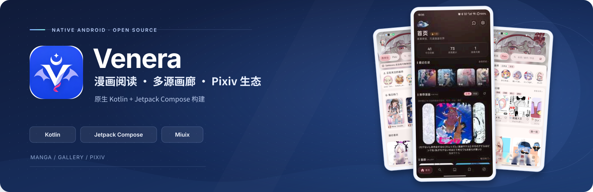
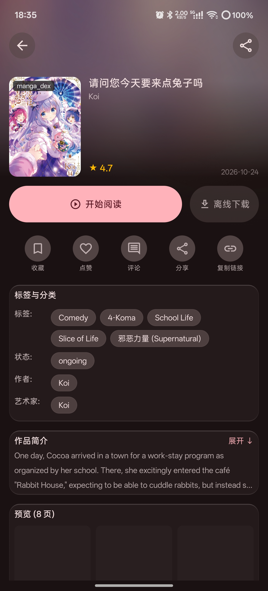
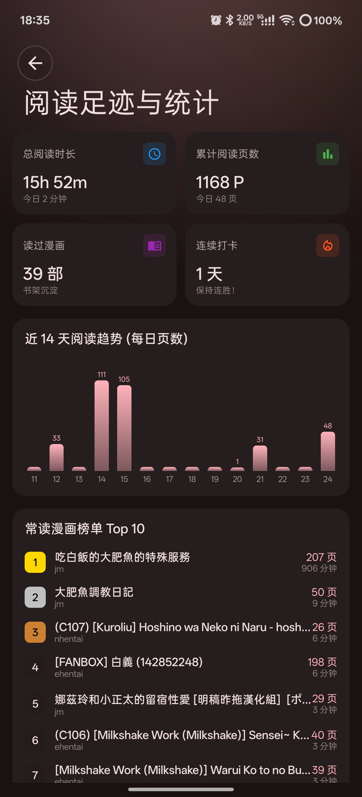
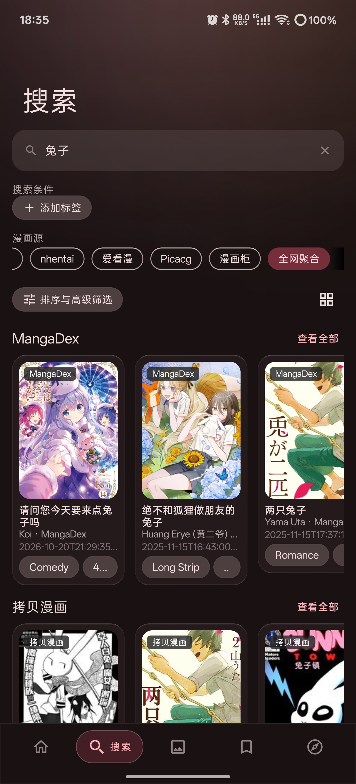
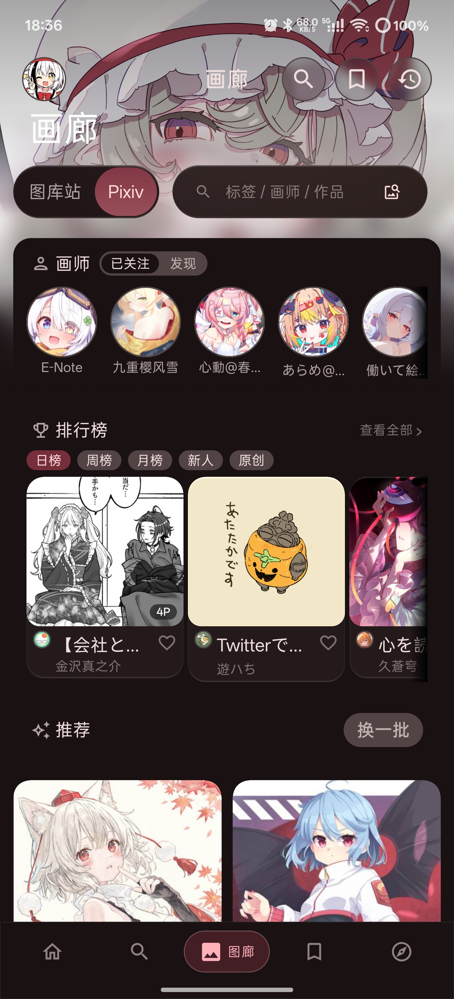
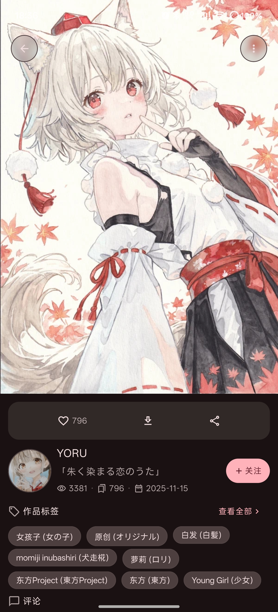
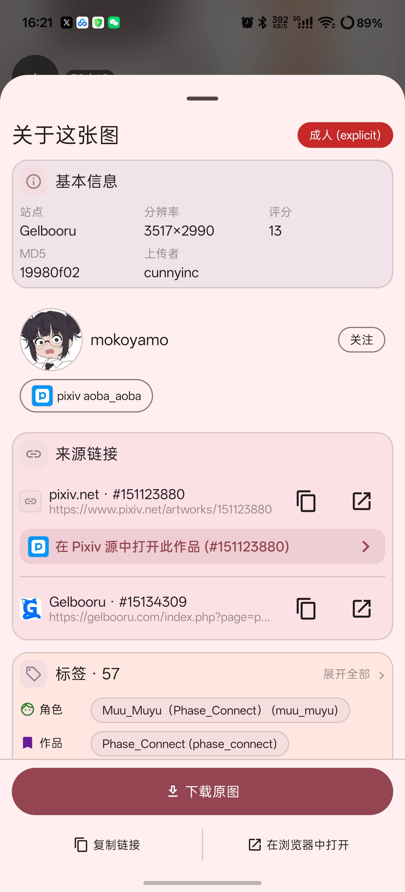

<div align="center">



[](https://github.com/w13630039663-bit/venera-miuix/releases)
[](https://github.com/w13630039663-bit/venera-miuix/tree/compose-migration)


[](LICENSE)

**简体中文** | [English](README.en.md)

</div>

---

## 界面截图

<p align="center">
  
  
  
  
  
</p>
<p align="center"><sub>漫画首页 · 搜索探索 · 漫画详情 · 阅读统计 · 多源聚合搜索</sub></p>

<p align="center">
  
  
  
  
  
  
</p>
<p align="center"><sub>画廊主墙 · Pixiv 首页 · Pixiv 画师主页 · 原生作品详情 · 图库直跳画师落地 · 来源一键直跳 Pixiv</sub></p>

---

## 目录

- [这是什么](#这是什么)
- [界面截图](#界面截图)
- [核心特性](#核心特性)
  - [画廊与 Pixiv 原生生态](#1-画廊与-pixiv-原生生态)
  - [漫画阅读器](#2-漫画阅读器)
  - [漫画源与网络引擎](#3-漫画源与网络引擎)
  - [收藏与历史](#4-收藏与历史)
  - [下载与本地书架](#5-下载与本地书架)
  - [分级、屏蔽与隐私](#6-分级屏蔽与隐私)
  - [外观与个性化](#7-外观与个性化)
- [已知缺口与明确不做](#已知缺口与明确不做)
- [下载与安装](#下载与安装)
- [从源码构建](#从源码构建)
- [架构与技术栈](#架构与技术栈)
- [许可证与致谢](#许可证与致谢)

---

## 这是什么

**Venera** 是一个优秀的开源漫画阅读器：用 JavaScript 编写漫画源插件，聚合阅读本地与网络漫画。

本分支把上游 Venera 的 Flutter 实现整体换成纯原生 Kotlin + Jetpack Compose，以小米 HyperOS 的 Miuix 设计体系重构全屏界面，并带来强大的原生画廊与 Pixiv 多源聚合模块。

本分支（`compose-migration`）专注以下四项核心革新：

1. **纯原生重构**：全量换用 Kotlin + Jetpack Compose，剔除 Flutter/Dart/Rust 运行时，更低内存占用与毫秒级冷启。
2. **Miuix 设计语言**：以小米 HyperOS 的 Miuix 体系与液态玻璃材质重做全屏，支持 Material 3 动态取色双风格无缝切换。
3. **兼容插件协议**：完全兼容官方 ComicSource JavaScript 插件协议，随包内置 34 个常用源脚本，支持一键导入与全部更新。
4. **画廊与 Pixiv 多源聚合**：底栏原生「画廊」模块，全面支持 Booru 系列图站与 Pixiv 双域聚合，支持原生作品页、画师页、账号体系与智能跨站直跳。

---

## 核心特性

### 1. 画廊与 Pixiv 原生生态

- **双域多源聚合**：顶栏药丸分段器无缝切换「图库站」（yande.re + Gelbooru + Safebooru）与「Pixiv」，状态机与主墙完全独立。
- **Pixiv 官方原生生态接入**：
  - **实时榜单与推荐**：日榜、周榜、月榜、新人、原创多档榜单；已登录账号自动接入官方推荐瀑布流（支持换一批），未登录支持基于收藏种子的智能推荐。
  - **原生作品详情（`PixivWorkActivity`）**：同作多页连读瀑布流、完整信息面板（多标签中文译名、作品统计数据）、直接官方收藏与关注画师、一键下载原图。
  - **原生画师主页（`PixivArtistActivity`）**：画师背景横幅、头像、插画/漫画/公开书签分栏及一键关注。
  - **个人 Pixiv 账号主页（`PixivAccountActivity`）**：动态、云端书签（公开与私密）、已关注画师名单，带重置置顶机制。
- **跨站智能跳转与 ID 直达**：
  - **来源链接嗅探直跳**：在图库站作品详情中，自动识别 Pixiv 来源并生成高亮跳转药丸，一键直达原生作品页。
  - **搜索框 ID / 链接直跳**：输入纯数字作品 ID、`#ID`、`id:ID` 或 Pixiv 网页链接直接秒级唤起作品详情。
- **关注画师平滑展开网格**：首页关注画师栏支持向下平滑展开为 5 列网格，同屏最多展示 10 位画师，支持固定高度纵向滚动。
- **极简纯图收藏主页与双轨解耦**：
  - 顶部单行「Pixiv 书签」卡片直通账号云端书签；
  - 本地收藏采用 3 列自适应纯图极简瀑布流（去除外边框与遮挡小红心）；
  - 统计栏右侧横向 Miuix 玻璃胶囊筛选排序（按图库站点、安全分级筛选及最新/最早排序）；
  - **收藏机制双轨隔离**：Pixiv 作品收藏直连官方接口，完全不污染本地图库数据库。
- **Pixiv 专属个性化设置**：
  - 卡片预览、作品页展示、大图全屏看图器分别独立支持「中画质 / 大图 / 原图」；
  - 专属保存路径与占位符命名模板（`{illust_id}`、`{part}`、`{title}`、`{user_id}`、`{artist_name}`）；
  - 网络模式与图片源（`i.pximg.net` / `i.pixiv.re` / 自定义 Host）配置。
- **全画廊 Miuix 动态毛玻璃磨砂（Blur Backdrop）**：画廊主页、日榜、收藏页、历史记录、Pixiv 账号页及作品页全链路挂载模糊采样源，向下滑动时顶栏平滑采样并实时模糊下方滚动内容。
- **画廊探索与工具**：每日热门、猜你喜欢、画师别名归一、SauceNAO 以图搜图、AI 涂抹与「画成水彩」功能。

### 2. 漫画阅读器

- **全阅读模式支持**：画卷（从上至下）、日漫（右至左）、美漫（左至右）、双页横折、竖屏连续。
- **阅读手感与控制**：双指跟手缩放、自动翻页巡航（1–10 秒可调）、音量键翻页、沉浸式全屏与屏幕常亮。
- **画面调节与色彩**：夜间反色、绿光保护色、对比度增强、锐化滤镜与色阶调整。
- **无缝阅读与连读**：翻至末页自动续翻下一话、保留章节精准续读进度（精准至上次那一话那一页）。

### 3. 漫画源与网络引擎

- **JavaScript 插件生态**：兼容上游插件协议，支持动态规则编译、分类树解析与搜索。
- **全自动网络过盾**：内置 Cloudflare 挑战自动处理与 Cookie/UA 动态绑定。
- **高性能传输体系**：支持 HTTP/SOCKS5 代理、域名熔断机制、DNS 优选 IP 路由、限速防封与图片多并发分发。
- **深层链接直达**：支持 29+ 常见漫画站网址从外部浏览器直接跳转唤起应用。

### 4. 收藏与历史

- **本地与网络双收藏**：多自定义收藏夹、封面跨页共享元素转场、网络源书架一键同步。
- **后台追更检测**：指定追更文件夹，后台轻量轮询更新并发送系统通知。
- **阅读历史与统计**：详细的阅读时长、阅读页数、近 14 天阅读曲线、最常阅读 Top 10 与题材偏好分布图。

### 5. 下载与本地书架

- **多线程高速下载**：1–16 并发可调，支持章节级多选、断点续传、失败重试与实时进度通知。
- **章节完整性与防伪校验**：自动识别假图、过盾页及空字节，不齐章节明确标记「离线不全」。
- **外部格式支持**：支持本地漫画目录自动扫描、CBZ 漫画归档导入与打包导出。

### 6. 分级、屏蔽与隐私

- **多层级内容遮罩**：无过滤 / 封面打码 / 彻底隐藏三态，结合规则与内置源预设执行。
- **精准屏蔽引擎**：支持按关键词、标签、画师与作品 ID 进行整词或正则匹配，内置显式 AI 内容一键屏蔽。
- **防窥保护**：系统级 `FLAG_SECURE`，防止在多任务视图和截图中泄露内容。

### 7. 外观与个性化

- **双界面风格**：原生 Material 3（支持 Android 12+ 动态壁纸取色）与 HyperOS Miuix 随心切换。
- **材质与动效**：支持液态悬浮玻璃底栏、动态毛玻璃磨砂（Blur Backdrop）与流畅交互反馈。
- **首页头图与装扮**：支持自定义主页与画廊专属顶栏头图、首页桌宠挂件。

---

## 已知缺口与明确不做

- **章节评论与日志查看器**：目前代码层具备基础定义，界面入口尚未接入。
- **桌面端（Windows / Linux / macOS）**：目前专注 Android 端原生演进；Windows 桌面线（`:desktop`）为独立实验模块。
- **生物识别与硬件锁**：暂不集成系统指纹面容锁，推荐使用系统级应用锁保护。
- **非官方声明**：第三方图源与站点请遵守对应站点服务条款，本仓库仅供学习与个人阅读使用。

---

## 下载与安装

预编译 APK 请前往 **[Releases](https://github.com/w13630039663-bit/venera-miuix/releases)** 页面下载。

| 安装包架构 | 适用设备 |
| :--- | :--- |
| `venera-miuix-universal.apk` | 通用安装包（兼容全部架构） |
| `venera-miuix-arm64-v8a.apk` | 绝大多数现代 Android 手机与平板（推荐） |
| `venera-miuix-armeabi-v7a.apk` | 老旧 32 位设备 |
| `venera-miuix-x86_64.apk` | PC 安卓模拟器 / Chromebook |

> **系统要求**：Android 13（API 33）及以上版本。

---

## 从源码构建

### 环境要求
- JDK 17 或 JDK 21
- Android SDK Platform 35 / Build-Tools 35.0.0

### 常用编译指令
```bash
# 编译调试包 APK
./gradlew :app:assembleDebug

# 编译全架构 Release 包
./gradlew :app:assembleRelease

# 运行单元测试
./gradlew :app:testDebugUnitTest
```

---

## 架构与技术栈

- **开发语言**：Kotlin 2.1+ / Kotlin Coroutines & Flow
- **界面框架**：Jetpack Compose 1.7+ / Miuix KMP / Material 3
- **图片加载与网络**：Coil 3 (Kotlin Multiplatform) / OkHttp 4
- **持久化与序列化**：SQLite (Room / SQLDelight) / kotlinx.serialization

---

## 许可证与致谢

- **协议**：本项目基于 **GNU General Public License v3.0 (GPL-3.0)** 开源。
- **上游致谢**：感谢原版 Venera 作者 [@wgh136](https://github.com/wgh136) 及其创新的插件体系。
- **组件致谢**：感谢 [Miuix-KMP](https://github.com/MiuiX-KMP/Miuix-KMP) 为 Compose 带来的出色 HyperOS 视觉体验。
