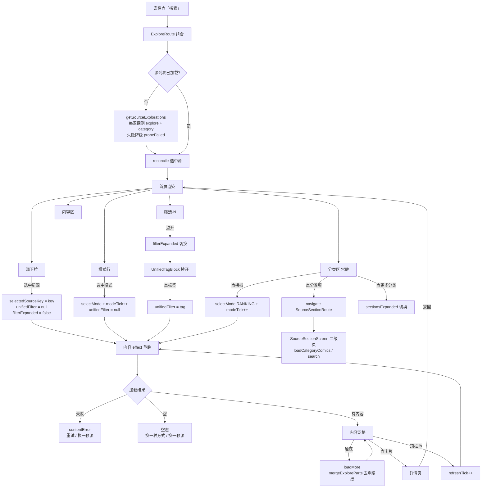

# Venera Android「探索」页只读审查报告

- 审查日期：2026-10-14
- 审查范围：探索页 UI、状态层、数据层、源脚本能力、导航与二级页
- 性质：**只读审查**。本次不修改任何代码，不提交 commit，不创建 PR
- 代码基线：工作区当前状态（含 2026-10-14 当天两轮改版：`折叠态按需展开` 与其后的 `探测容错 + 分类回常驻 + 删副标题`）

> 阅读约定：本文每条结论标注 **[事实]**（读代码/读脚本即可确认）、**[推测]**（由代码结构推断、未运行验证）、**[待验证]**（需真机或日志才能定论）。

---

## 0. 摘要

探索页是一个**单页三层**结构：选源 → 选入口（模式 / 分类 / 筛选）→ 看内容。它的复杂度不在 UI，而在**它要同时兜住 34 颗结构完全不同的源脚本**：有的源探索页只有 1 页，有的 3 页；有的返回多分区，有的返回分页列表；有的用页码翻页，有的用 next URL 游标；有的没有分类、只有排行榜。

当前实现把「源差异」收敛在 `SourceExploration` 这一层抽象里，UI 只读抽象结果 —— 这个方向是对的。**真正的问题集中在三处**：

1. **适配层分页语义不统一**（[事实]）：`search` 适配层维护了 next 游标缓存，`loadExplorePage` 适配层没有，对 `loadNext` 型源（ehentai）直接传页码字符串 —— 疑似第 2 页起请求失败。
2. **首屏 chrome 与浏览效率的取舍摇摆**（[事实]）：同一天内「分类折进按钮」与「分类回常驻」来回改了一次，说明这个取舍没有稳定判据。
3. **源选择器的形态反复**（[事实]）：药丸横滑 → M3 暴露式下拉 → 自绘下拉，三次改版；截图里的「窄菜单压住分类标签」正是 M3 暴露式下拉那一版的固有行为。

---

## 1. 页面架构树与关键文件清单

### 1.1 关键文件清单

| 文件 | 行数 | 职责 |
|---|---|---|
| `app/src/main/java/com/venera/compose/feature/explore/UnifiedExploreScreen.kt` | ~1400 | 探索页全部 UI（唯一 Composable 入口 + 全部私有子件） |
| `app/src/main/java/com/venera/compose/feature/explore/ExploreViewModel.kt` | ~150 | 页面状态（`ExploreViewModel` + 二级页 `SourceSectionViewModel`） |
| `app/src/main/java/com/venera/compose/feature/explore/ExploreState.kt` | 44 | 跨源 UI 状态（`ExploreUiState`：选中源 + 每源模式记忆） |
| `app/src/main/java/com/venera/compose/feature/explore/ExplorePolicy.kt` | ~140 | 纯逻辑（无 Compose 依赖，可单测）：标题翻译、显隐判据、错误文案 |
| `app/src/main/java/com/venera/compose/feature/explore/ExploreContent.kt` | 38 | 内容展示形态 sealed interface（Empty / Sections / ComicList） |
| `app/src/main/java/com/venera/compose/feature/explore/SourceSectionScreen.kt` | 578 | 二级分类页（点分类入口后进入） |
| `app/src/main/java/com/venera/compose/source/explore/SourceExploration.kt` | 269 | 数据模型 + `SourceExplorationFactory`（源能力 → UI 模型的唯一收敛点） |
| `app/src/main/java/com/venera/compose/source/ComicSourceManager.kt` | ~1250 | 源注册表与统一调用面（`getSourceExplorations:1159`、`loadExplorePage:1140`、`search:887` 等） |
| `app/src/main/java/com/venera/compose/source/ComicSource.kt` | ~90 | 源接口定义 |
| `app/src/main/java/com/venera/compose/source/js/JsComicSource.kt` | ~1100 | JS 源适配层（`loadExplorePage:962`、`search` 适配、`getCategoryData:1054`） |
| `app/src/main/java/com/venera/compose/feature/Navigation.kt` | 1218 | 路由注册（`ExploreRoute:140`、`composable<ExploreRoute>:950`、`SourceSectionRoute:975`） |
| `app/src/main/java/com/venera/compose/components/VeneraFloatingNavBar.kt` | — | 底部导航（`VeneraNavTab:34`、`EXPLORE:53`） |
| `app/src/main/assets/sources/*.js` | 34 源 | 各源自己实现的 explore / category / categoryComics / search |

### 1.2 架构树

```
VeneraComposeApp（Navigation.kt）
├── VeneraFloatingNavBar（底栏，EXPLORE tab = "探索"）
│     └── VeneraNavTab.EXPLORE → ExploreRoute（Navigation.kt:416, 434, 524）
│
├── composable<ExploreRoute>（Navigation.kt:950）
│     └── CoverTransitionHost
│           └── UnifiedExploreScreen(onSelectComic, onOpenNativeSection)   ← 探索页唯一入口
│                 ├── Box
│                 │    ├── LazyColumn（全页唯一滚动容器）
│                 │    │    ├── item "source-picker"     → SourceDropdownField(:851)     源选择
│                 │    │    ├── item "modes-*"           → ExploreModeRow(:970)          模式行（>1 模式才渲染）
│                 │    │    ├── item "actions-*"         → ExploreActionRow(:1044)       动作行（筛选·N + 右槽）
│                 │    │    ├── item "filter-open-*"     → UnifiedTagBlock(:1098)        筛选展开区（可选）
│                 │    │    ├── item "ranking-*"         → NativeSectionBlock(:996)      榜档组（常驻，首项）
│                 │    │    ├── itemsIndexed "sec-*"     → NativeSectionBlock(:996)      分类组（常驻，8 入口预算）
│                 │    │    ├── item "sections-more-*"   → SectionMoreButton(:1124)      更多分类
│                 │    │    ├── item "content-header-*"  → SectionHeader(:943)           内容节头（有内容才摆）
│                 │    │    ├── 内容分支：CenteredLoader(:954) / VeneraEmptyView(错误、探测失败、空) /
│                 │    │    │            Sections 分区（PartHeader:1144 + 卡片行）/ ComicList 网格
│                 │    │    └── item "load-more"         → LoadMoreFooter(:1348)         触底翻页
│                 │    └── VeneraTopAppBar（title="探索"，无副标题；actions = 布局切换 + 刷新）
│                 │
│                 └── （跨导航条目）ExploreViewModel ← viewModel()（Navigation.kt 条目级 Store）
│
├── composable<SourceSectionRoute>（Navigation.kt:975）
│     └── SourceSectionScreen（二级分类页，578 行）
│
└── composable<ComicDetailRoute>（详情页，不在本次范围）
```

---

## 2. 页面结构详解

### 2.1 入口与容器

**[事实]** `UnifiedExploreScreen`（`UnifiedExploreScreen.kt:133`）是探索页唯一入口，由 `Navigation.kt:950` 的 `composable<ExploreRoute>` 渲染，两个回调：
- `onSelectComic` → 详情页
- `onOpenNativeSection` → `navController.navigate(SourceSectionRoute(...))`（Navigation.kt:956-971，七字段搬运：sourceKey / sourceTitle / category / param / unifiedTag / page / keyword）

**[事实]** 底栏由 `VeneraFloatingNavBar.kt:53` 定义 `EXPLORE("探索", ...)`；`Navigation.kt:416/434/524` 三处把 `ExploreRoute` 映射到 `VeneraNavTab.EXPLORE`（路由 → tab、tab → 路由、当前目的地 → tab 三向同源）。

**[事实]** 页面状态挂在 `ExploreViewModel`（`ExploreViewModel.kt:25`），由 `viewModel()` 获取（`UnifiedExploreScreen.kt:137`）。KDoc 明确记录理由：进详情页时导航条目组合被销毁，`remember` 字段会全部重建，于是每次返回都重拉源列表并跳回第一个源的默认模式；`ViewModelStore` 挂在导航条目上则不销毁。

### 2.2 顶部工具栏

**[事实]** `VeneraTopAppBar(title = "探索", largeTitle = "探索")`（`UnifiedExploreScreen.kt:759` 附近），`actions` 两枚：
- `ComicLayoutToggleButton`（卡片布局切换，写入全局 `rememberComicListDisplayMode`）
- 刷新按钮 `VeneraTopBarPill` → `refreshTick++`

**[事实]** 副标题已于 2026-10-14 第二轮删除（原 `subtitle = subtitleText` 与配套 24dp 地板补偿项 `Spacing.topBarSubtitleExtra` 一并删除）。内容顶部留白回到 `statusBarTop + topBarFloor(104dp)`（`UnifiedExploreScreen.kt:358` 附近）。

### 2.3 源选择器

**[事实]** 当前实现为自绘下拉 `SourceDropdownField`（`UnifiedExploreScreen.kt:851`）：
- 锚点：`Surface(shape = shape.medium, color = surfaceContainerHigh, border = outlineVariant)` + 源名 + `Icons.Filled.ArrowDropDown`
- 菜单：M3 `DropdownMenu`（实底 `color.surface`），内容为 `Column(verticalScroll)`，高度上限 `sheetActionHeight * 6`
- 探测失败的源在菜单项里带副文案「暂不可达 · 点击进入可重试」（`probeFailed` 标记，见 4.3）

**[事实]** 历史形态（同一天内）：`SourcePicker`（`LazyRow` 药丸横滑）→ `ExposedDropdownMenuBox`（M3 暴露式下拉）→ 自绘 `DropdownMenu`。截图中的「窄菜单」属第二阶段（M3 暴露式）版本，见 §5.1。

### 2.4 模式行 / 分类区 / 筛选

**[事实]** 模式行 `ExploreModeRow`（:970）：`LazyRow` 横滑 `VeneraChip`，无节头；整行显隐由 `exploreModeRowVisible(modes) = modes.size > 1` 判定（`ExplorePolicy.kt:90`），榜档（`Kind.RANKING`）不进此行（`UnifiedExploreScreen.kt:432` 过滤）。

**[事实]** 分类区**常驻**（:482-483）：
```kotlin
val hasAnyCategoryEntry = visibleSections.isNotEmpty() || src.rankingSection?.items?.isNotEmpty() == true
if (hasAnyCategoryEntry) { ... }
```
- 首屏预算：按组顺序消耗 `SECTION_ENTRY_BUDGET = 8`（`ExploreViewModel.kt:110`），单组上限 `SECTION_ITEM_CAP = 20`（:119）
- 零入口组在源头剔除（`allSections = currentSource?.nativeSections.orEmpty().filter { it.items.isNotEmpty() }`）
- 榜档组（`rankingSection`）排在分类组之前且不吃预算
- 尾巴进 `SectionMoreButton`（:1124，「更多分类（还有 N 个）」）

**[事实]** 筛选：动作行只有一枚「筛选 · N」（`ExploreActionRow:1044`），N = `filterEntryCount(availability)`；展开后 `UnifiedTagBlock`（:1098）摊开通用标签 `FlowRow`；右槽念「正在按「X」筛选」+「清除」。

### 2.5 内容列表

**[事实]** `ExploreContent`（`ExploreContent.kt:13`）三态：`Empty` / `Sections(parts)` / `ComicList(comics, page, maxPage, hasMore)`。渲染分支（`UnifiedExploreScreen.kt:560-740`）：

| 分支 | 触发 | UI |
|---|---|---|
| 加载中 | `isLoadingContent` | `CenteredLoader`（M3 波浪环） |
| 错误 | `contentError != null` | `VeneraEmptyView(重试)` + 「换一颗源」chip |
| 探测失败源 | `src.probeFailed` | `VeneraEmptyView(重新检测)` → `refreshTick++` |
| 空 | `content.isEmpty` | `VeneraEmptyView("这一格现在没有内容")` + 出路 chips |
| 分区 | `content is Sections` | 每 part：`PartHeader`（可带「查看更多 ›」）+ 卡片行 |
| 列表 | `content is ComicList` | `comics.chunked(columns)` 逐行 `items` |

**[事实]** 网格虚拟化纪律：全页唯一 `LazyColumn`，`items(comics.chunked(columns))` 逐行挂载，**绝不**在 item 内嵌套同向 `LazyVerticalGrid`（会因无界最大高度抛 `IllegalStateException`）。列数 = `comicListColumnCount(displayMode, 实测宽)`。

**[事实]** 触底翻页：footer item 进入组合即触发 `loadMore()`（:270），新页经 `mergeExploreParts`（`ExplorePolicy.kt:34`）同名分区续接 + `(sourceKey, id)` 去重后**原地追加**（`accumulatedParts` 保留原始未过滤数据，`buildExploreContent` 只重建展示层）。

### 2.6 空状态与底部导航

**[事实]** 空态（:608）标题「这一格现在没有内容」，正文分两种（有筛选 / 无筛选），出路 chips 两枚：「换一种方式」（`exploreModeRowVisible` 门控）、「换一颗源」（`explorations.size > 1` 门控）；「挑一个分类」chip 已随分类常驻删除。

**[事实]** 底栏：探索页作为主 Tab 之一，底栏常驻；二级分类页（`SourceSectionRoute`）`currentTab = null`，底栏与壳顶栏隐藏（`Navigation.kt:524` 附近注释）。

---

## 3. 状态与数据流调用链

### 3.1 状态清单（`ExploreViewModel` + `ExploreUiState`）

| 状态 | 位置 | 语义 |
|---|---|---|
| `explorations: List<SourceExploration>` | VM:30 | 已启用且非空的源（探测失败的源也保留） |
| `isLoadingSources` / `sourceError` | VM:31/32 | 源列表加载态 |
| `lastGoodExplorations` | VM:41 | 上次成功探测的源（内存缓存，兜底网络抖动） |
| `content: ExploreContent` | VM:43 | 当前展示内容 |
| `isLoadingContent` / `contentError` | VM:44/45 | 内容加载态 |
| `currentPage` / `hasMore` / `isLoadingMore` / `loadMoreError` | VM:47-50 | 分页 |
| `accumulatedParts` | VM:53 | 跨页累计原始分区（分页追加与去重的唯一数据源） |
| `showAsSections` | VM:56 | 展示形态（分区 or 平铺） |
| `refreshTick` / `modeTick` | VM:59/62 | 重载计数器（重载源列表 / 重拉内容） |
| `sourcesLoadedForTick` / `contentLoadedKey` | VM:68/71 | 返回本页时的「已加载」哨兵，防重复请求 |
| `unifiedFilter: UnifiedTag?` | VM:79 | 跨源通用标签筛选 |
| `sectionsExpanded` | VM:91 | 「更多分类」展开 |
| `filterExpanded` | VM:101 | 筛选区展开 |
| `selectedSourceKey` / `perSourceMode` | State:21/24 | 选中源 + 每源各自的模式记忆 |

### 3.2 调用链

**① 源列表加载**（`UnifiedExploreScreen.kt:173`）

```
LaunchedEffect(refreshTick)
 → 若 sourcesLoadedForTick == refreshTick 且列表非空 → 直接返回（防返回重拉）
 → ComicSourceManager.getSourceExplorations()            [Manager:1159]
     → registeredSources.filter { isSourceEnabled }      [Manager:1160]
     → 每源：source.getExplorePages() + source.getCategoryData()
         → JsComicSource.getExplorePages()  （JS 引擎求值 s.explore[]）   [Js:915+]
         → JsComicSource.getCategoryData()  （JS 引擎求值 s.category）    [Js:1054]
     → SourceExplorationFactory.build(...)                [SourceExploration:142]
         → buildModes()：explore 页 → ExploreMode；ranking options → RANKING 模式
         → CategoryPart → NativeSection（type=="random" 时套 randomWindow）
     → try/catch：探测抛异常 → SourceExploration(probeFailed = true)   ← 降级保留
     → filter { !isEmpty }（probeFailed 的 isEmpty 恒 false，不会被剔）
 → VM 侧缓存兜底：本轮 probeFailed 的源，若 lastGoodExplorations 里有同 key → 沿用旧结果
 → 选中源 reconcile：保留原选中（若仍存在）→ 否则第一颗非失败源 → 否则第一颗
```

**② 内容加载**（:225）

```
LaunchedEffect(currentSource?.sourceKey, currentSource?.modes, refreshTick, modeTick, vm.unifiedFilter)
 → src/mode 任一为 null → content = Empty, 清 accumulatedParts, return
 → loadKey = "$refreshTick|${src.sourceKey}|$scopeLabel"（scopeLabel = tag:X 或 mode:Y）
 → 若 contentLoadedKey == loadKey 且 accumulatedParts 非空 → 直接返回（防返回重拉）
 → fetchPageParts(src, mode, 1)                          [:218]
     ├─ vm.unifiedFilter != null → manager.search(key, filter.label, page, null)  [Manager:887]
     │                              → JsComicSource.search（load 或 loadNext + nextTokenCache）
     └─ 否则 → fetchModeParts(manager, src, mode, page)   [:772]
                ├─ Kind.RANKING → manager.loadCategoryRanking(key, option, page)   [Manager:1230]
                └─ EXPLORE_PAGE / EXPLORE_MULTI_PART →
                     manager.loadExplorePage(key, mode.pageIndex, page)            [Manager:1140]
                     → JsComicSource.loadExplorePage(pageIndex, page)              [Js:962]
                        → JS: s.explore[i] 按 type 分派：
                            singlePageWithMultiPart → exp.load()
                            multiPageComicList      → exp.load(page) 或 exp.loadNext(page==1 ? null : String(page))
                            mixed                   → exp.loadMixed(page)
                        → 解析：singlePageWithMultiPart → 逐分区；其他 → {comics} 单分区
 → showAsSections = unifiedFilter == null && kind == EXPLORE_MULTI_PART && !(单空标题分区)
 → hasMore = (unifiedFilter != null || kind != EXPLORE_MULTI_PART) && raw.any { comics 非空 }
 → content = buildExploreContent(guard, raw, showAsSections, 1, hasMore, nsfwMaskMode)
```

**③ 分页**（:270 `loadMore`）

```
footer 进入组合 → LaunchedEffect(currentPage) { if (!isLoadingMore && loadMoreError == null) loadMore() }
 → fetchPageParts(src, mode, currentPage + 1)
 → accumulatedParts = mergeExploreParts(accumulatedParts, raw)   ← 同名分区续接 + 去重
 → hasMore = raw 非空且任一分区有内容
 → content = buildExploreContent(guard, accumulatedParts, ...)
```

**④ 刷新**：顶栏 ↻ / 错误重试（内容） / 空源重试 → `refreshTick++`；探测失败源「重新检测」→ `refreshTick++`；模式切换与空态「换一种方式」→ `modeTick++`。

**⑤ 源切换**（:368-377）：`state.selectedSourceKey = key` → `unifiedFilter = null` → `filterExpanded = false`。

**⑥ 筛选**：`vm.unifiedFilter = tag`（再点同一枚 = null）→ 触发内容 effect 重跑（key 里含 `vm.unifiedFilter`）。

**⑦ 分类下钻**：`onEntryClick` → `onOpenNativeSection(NativeSectionArgs(...))`（:536-548，带 `page`/`keyword` 原样透传）→ `navigate(SourceSectionRoute)` → `SourceSectionScreen`。

**⑧ 二级页**（`SourceSectionScreen.kt:98`）：`LaunchedEffect(reloadTick, selectedOptions)` → `load(1)`：
- 通用标签 → `manager.search`（maxPage 传 null，维持冻结行为）
- search 型入口 → `manager.search`（用源给的真实 maxPage）
- 否则 → `manager.loadCategoryComics(key, category, param, options, page)` [Manager:1218]
- 筛选项：`manager.getCategoryComicsOptions`（:1208）→ `options` + `selectedOptions`（默认取每组第一项）
- 顶栏 `bottomContent` 的选项药丸是**浮层**，量高后计入 `contentPadding.top`（`chipsHeight`，:220-227）

---

## 4. 不同漫画源的能力差异

### 4.1 六个代表源的实际结构（[事实]，逐一读源脚本）

| 源 | explore 页数 / 结构 | `type` | 分类（`category.parts`） | 排行榜 | search options |
|---|---|---|---|---|---|
| **包子漫画** `baozi.js` | 1 页（title="包子漫画"），`load()` 无参 | `singlePageWithMultiPart` | 有（「类型」fixed 组，含「全部」） | 无 | 无 options |
| **拷贝漫画** `copy_manga.js:208` | 1 页，`load()` 无参 | `singlePageWithMultiPart` | 有 | 无 | 无 options |
| **禁漫天堂** `jm.js:384` | 1 页（title="禁漫天堂"），`load(page)` 返回 `[{title, comics, viewMore}]` | `multiPartPage` | 有（含 `itemType: "search"` 的组，如「特殊PLAY」） | `enableRankingPage: true` | 有（`o` 排序参数） |
| **MangaDex** `manga_dex.js:182` | 1 页，`load(page)` 返回 3 个 part（Popular/Recent/Updated），每 part 带 `viewMore → search` 属性 | `multiPartPage` | — | `enableRankingPage: false` | **三段**（排序 / 内容分级 / 状态），缺段会拼出 `undefined` |
| **ehentai** `ehentai.js:391` | **3 页**（eh latest / eh popular / eh watched），`loadNext(next)` | `multiPageComicList` | `parts: []`（**无分类**） | `enableRankingPage: true`（15/13/12/11 档） | `loadNext(keyword, options, next)`，三段 options |
| **nhentai** `nhentai.js:470` | 1 页，`loadMixed(page)` | `mixed` | 有（含 `type: "random"` + `randomNumber: 20` 的组、`groupParam: "language"` 的语言组） | `enableRankingPage: true` | 有 |

### 4.2 框架统一提供 vs 源自己实现

**[事实]** 框架统一提供（`SourceExplorationFactory` + `JsComicSource` 适配层）：

| 能力 | 统一实现 | 位置 |
|---|---|---|
| explore 页 → 模式 | `buildModes()`：type 映射 `singlePageWithMultiPart → EXPLORE_MULTI_PART`，其余 → `EXPLORE_PAGE` | `SourceExploration.kt:174` |
| 排行榜档位 → 模式 | `categoryData.rankingOptions` 逐档成 `RANKING` 模式（不再硬编码 `"day"`） | `SourceExploration.kt:200` |
| 分类 → 分区模型 | `CategoryPart → NativeSection`；`type == "random"` 套 `randomWindow`（对齐官方 `category.dart:82-86`） | `SourceExploration.kt:213/259` |
| `groupParam` 整组覆盖 param | JS 侧适配（nhentai 语言组依赖它） | `JsComicSource.kt:1075+` |
| search/category 型入口区分 | `NativeEntry.page`（`PAGE_KIND_CATEGORY` / `PAGE_KIND_SEARCH`）原样透传 `itemType` | `SourceExploration.kt:105/124-128` |
| 分页续接与去重 | `mergeExploreParts`（同名分区续接 + `(sourceKey,id)` 去重） | `ExplorePolicy.kt:34` |
| 分区标题翻译 | `explorePageTitle`（只翻通用页面名，源品牌名原样保留） | `ExplorePolicy.kt:49` |
| 内容守卫过滤 | `buildExploreContent` 按 `HIDE/BLUR/OFF` 分流（BLUR 严禁剔除） | `UnifiedExploreScreen.kt:798` |

**[事实]** 源自己实现（每源脚本内）：

- explore 的**页数与页内结构**（1 页 / 3 页；分区式 / 列表式 / mixed）
- **分页协议**：`load(page)` 页码型（jm / manga_dex / nhentai）vs `loadNext(next)` 游标型（ehentai）vs `{comics, maxPage}`（categoryComics）
- **分类分区**的组数、组内项数、命名、`itemType`
- **排行榜档位**（jm 的 `mv/mv_m/mv_w/mv_t`、ehentai 的 15/13/12/11 —— 源自己声明，框架不臆造）
- **search options 的段数与语义**（MangaDex 三段 / ehentai 三段 / baozi 无）

**[事实]** 关键结论：**不能假定所有源一致**。三个直接后果：
1. `hasMore` 只能用「有内容就可能有下一页」的粗判（下一轮空了才停），因为框架不知道源的页数上限。
2. `singlePageWithMultiPart` 与 `multiPartPage` 都映射到「非 EXPLORE_PAGE」分支，前者永不翻页、后者按页翻 —— 二者在 UI 上不可区分，靠 `showAsSections` 分流。
3. MangaDex 的 `viewMore` 带 `page: "search"` + 三段 options（`manga_dex.js:196-210`），这条链路必须把 options 数组原样传到 `search`，**任何"只传第一个 option"的实现都会拼出 `undefined`**。

### 4.3 探测容错（2026-10-14 第二轮新增）

**[事实]** `SourceExploration.probeFailed`（`SourceExploration.kt:47`）+ `getSourceExplorations` 的 try/catch 降级（`ComicSourceManager.kt:1159-1180`）+ VM 缓存兜底（`lastGoodExplorations`，`ExploreViewModel.kt:41`）。

**[事实]** `isEmpty` 语义随之改变：`!probeFailed && modes.isEmpty() && nativeSections.isEmpty() && !hasRanking` —— 探测失败的源不再被 `filter { !isEmpty }` 剔除。

---

## 5. 交互与状态问题

### 5.1 「窄菜单压住分类标签」的成因（用户重点问题）

截图（2026-10-14 16:57 / 18:26）对应 **M3 `ExposedDropdownMenuBox` 版本**，三条成因互相叠加：

**[事实] ① 浮层 z-order：菜单是 Popup，天然盖住下方 chrome。**
`ExposedDropdownMenu` 内部是独立 `Popup` 窗口，z-order 在页面内容（`LazyColumn`）之上，锚定在源下拉格正下方。源下拉格是 `LazyColumn` 的**第一个 item**，它下面依次是模式行、动作行、分类区 —— 菜单一展开，这三行全部被压住。截图里「筛选 · 3 / 分类 · 15」那行被菜单盖住，就是这个机制，与「窄」无关。

**[事实] ② 菜单宽度 = 锚点宽度。**
M3 `ExposedDropdownMenuBox` 的设计行为是菜单宽度跟随 `menuAnchor` 宽度。锚点是 `Modifier.fillMaxWidth()` 的源下拉格，位于 `contentPadding`（`rowHorizontal = 14dp`）内，所以菜单左右比屏幕窄 28dp，与下方卡片网格**左缘对齐但视觉上像"贴上去的一块"**；长源名（「拷贝漫画(多账号)」「少年ジャンプ＋」「カドコミ」）在受限宽度下被截断。

**[推测] ③ LazyColumn item 内的 Popup 锚定不稳。**
锚点在 LazyColumn 的 item 内，item 随列表滚动；Popup 定位依赖锚点在窗口中的坐标快照。item 滚出视口（被回收）后菜单是否悬空/错位，未运行验证 → 见 §10 待验证项。

**[事实] 当前代码已换成自绘 `DropdownMenu`（:851）**：宽度自适应内容（修复「窄」与截断），菜单内 `Column(verticalScroll)` 限高 `sheetActionHeight * 6`。**但浮层覆盖行为不变**（M3 `DropdownMenu` 同样是 Popup），点外部或按返回关闭 —— 这是所有下拉形态的共同代价，不是 bug。

### 5.2 其他交互与状态问题

| # | 问题 | 类型 | 依据 |
|---|---|---|---|
| 1 | 模式行是 `LazyRow` 横滑，**无渐隐提示**，超出屏宽的模式不可见（与仓库其他横向行「渐隐成对」的既有做法不一致） | [事实] | :978，回滚方案文档记过「横向行的渐隐与尾部内边距成对」判据 |
| 2 | 分类区常驻后，多组源（如 mh1234「题材」343 枚）首屏仍可能占 3~4 行；预算 8 是组级、`SECTION_ITEM_CAP` 20 是组内级，两闸叠加后首屏高度需真机量 | [待验证] | :340-345（预算实现） |
| 3 | `hasMore` 粗判导致**多一次空请求**：最后一页之后仍会触发一次 `loadMore`，靠返回空才停 | [事实] | :239 / :264 |
| 4 | 切源后**滚动位置不重置**：`LazyColumn` 未持 `rememberLazyListState`，靠默认状态；切源内容变化后停在原滚动位置可能显示到内容中段 | [推测] | 未发现显式 `scrollToItem(0)` 调用 |
| 5 | 探测失败的源：下拉里可见、点进去有「重新检测」，但**不会自动重探**（需手动 ↻ 或点按钮） | [事实] | :600（probeFailed 分支） |
| 6 | 空态出路与错误态出路的「换一颗源」是**顺序切下一颗**，34 颗源时可能要按很多次才能到目标源 | [事实] | :555（`switchToNextSource`） |
| 7 | 筛选（`unifiedFilter`）是「源内搜索」，与模式**互斥**（选模式清筛选、选筛选清模式）；但 UI 上两者都常驻可见，用户可能不理解为何点筛选后模式行的选中态失效 | [事实] | :225（effect key 含 unifiedFilter）/ :443（选模式清筛选） |
| 8 | `contentLoadedKey` 哨兵含 `refreshTick`：从详情页返回不重拉，但**手动 ↻ 后返回会重拉一次**（key 已变） | [事实] | :71 / :237 |

### 5.3 状态重置纪律（现状）

**[事实]** 已实现的互斥与重置：
- 切源 → `unifiedFilter = null` + `filterExpanded = false`（:368-376）
- 选模式 → `unifiedFilter = null` + `filterExpanded = false`（:426-433）
- 点同一枚标签 → `unifiedFilter = null`（取消）
- 切源/切模式 → 内容 effect 重跑，`accumulatedParts` 重置

**[事实]** 未重置的：
- `sectionsExpanded`（「更多分类」展开态）**切源不重置** —— 若上一个源展开了「更多」，切到新源后仍是展开态（预算失效）。这是一个**实际的状态泄漏**。
- 滚动位置（见 5.2 #4）

---

## 6. 组件与重构风险

### 6.1 可独立拆分的 UI

**[事实]** `UnifiedExploreScreen.kt` 单文件 ~1400 行，内部全是 `private` 子件。可拆的边界（按耦合度从低到高）：

| 组件 | 行号 | 拆分可行性 | 说明 |
|---|---|---|---|
| `SourceDropdownField` | :851 | 高 | 只依赖 `List<SourceExploration>` + 选中 key，无页面状态 |
| `ExploreModeRow` | :970 | 高 | 只依赖 `List<ExploreMode>` |
| `NativeSectionBlock` / `SectionMoreButton` | :996 / :1124 | 高 | 只依赖 `NativeSection` |
| `ExploreActionRow` / `UnifiedTagBlock` | :1044 / :1098 | 高 | 纯展示 + 回调 |
| `PartHeader` / 卡片行 / `LoadMoreFooter` | :1144+ | 中 | 卡片行与 `ComicItem`/共享元素过渡耦合 |
| `fetchModeParts` / `buildExploreContent` | :772 / :798 | 中 | 已是顶层私有函数，可移入 Policy 层（`buildExploreContent` 依赖 `ContentGuardManager`） |

**[事实]** 拆分需注意仓库硬约束：新文件若含 `viewModel()` 字面量会影响 `ViewModelAssemblyGuardTest` 计数；`SectionHeader`/`CenteredLoader` 等是文件内私有件，多页各自持有同名副本（`SourceSectionScreen` 也有自己的 `CenteredLoader`）。

### 6.2 与具体源耦合的逻辑

**[事实]** UI 层对源**无硬编码**（这是现有设计的主要优点）：模式、分类、筛选项全部来自 `SourceExploration`。仅存的源相关常量在别处：
- `HomeViewModel` 的 `NORMAL_/R18_RECOMMEND_SOURCES`（首页推荐源集，与探索页无关）
- `SourceExplorationFactory.randomWindow` 的随机窗口对齐 nhentai 的 `randomNumber`
- `UnifiedTags.kt` 的通用标签映射（应用层可选映射，绝不覆盖源原生 Tag）

**[事实]** 真正的耦合风险在**适配层**：`JsComicSource.loadExplorePage`（:962）按 `type` 字符串分派，新增一种 type 需同时改适配层与 `SourceExplorationFactory.buildModes` 的映射（两处都认 `type`，容易分叉）。

### 6.3 布局调整会影响的既有功能

| 若改动 | 影响 |
|---|---|
| 顶部 chrome 行高 / 增删行 | `TopBarFloorGuardTest`（104dp 地板 + 白名单）、`contentPadding.top` 相加链；顶栏重叠是本仓量过的故障族 |
| 源下拉形态 | `UiAuditBatch7Test`（假开关判据）、`ExploreEmptyStateTest`、`UiAuditBatch4Test` 的分类判据可能连带失效 |
| 分类区预算数值 | `ExplorePolicyTest`（`SECTION_ENTRY_BUDGET` / `SECTION_ITEM_CAP` 相关断言） |
| 返回导航 | `Navigation.kt:434/524` 三向 tab 映射；`SourceSectionRoute` 的 `currentTab = null`（二级页底栏隐藏）；路由载荷只放 `String`（`rememberSaveable` 装不下对象） |
| 滚动位置 | 加 `rememberLazyListState` 需与「返回不重拉」哨兵（`contentLoadedKey`）配合，否则返回后滚动位置与内容重建时序打架 |
| 分页 | `mergeExploreParts` 的同名续接语义；改动分页会动 `accumulatedParts` 与 `buildExploreContent` 的契约 |
| 筛选状态 | `unifiedFilter` 参与内容 effect 的 key；改 key 会破坏「返回不重拉」 |

---

## 7. 设计方案（三种 + 推荐）

### 方案 A：自绘下拉 + 分类常驻（= 当前形态，做增量打磨）

- **形态**：源下拉一行（自绘 `DropdownMenu`）+ 模式行 + 筛选开关 + 常驻分类区
- **操作成本**：换源 1 次点击（下拉展开 + 选中 = 2 次点按）；分类 1 次点击
- **空间占用**：首屏 chrome 约 3 行（源 / 模式 / 分类起始行），内容从第 2 屏可见
- **实现复杂度**：低（当前代码已在此形态）
- **兼容性**：好；`LazyColumn` 结构不变，判据测试基本沿用
- **遗留代价**：下拉是 Popup，展开时仍会盖住下方 chrome（点外部关闭）；34 源需滚动

### 方案 B：源选择改为底部面板（`ModalBottomSheet`）

- **形态**：顶部只留一行「当前源 ▾」按钮（或干脆用顶栏副标题位），点开从底部升起面板；面板内可按「最近使用 / 全部」分组，带搜索框
- **操作成本**：换源 2 次点击（开面板 + 选）；但**定位效率高**（搜索 / 分组）
- **空间占用**：面板浮层覆盖下半屏，首屏 chrome 可压到 1 行
- **实现复杂度**：中 —— 回滚方案（`_qa/explore-revert-2026-10-14/_trash/explore-content-first-2026-10-14.md`）做过 ModalBottomSheet 版筛选面板，踩过两个坑：① 高度锚点（`GalleryInfoSheet` 一族「展开动画逐帧重算锚点」）；② `enabledValues` 需限定 `Hidden/Expanded` 两档
- **兼容性**：需新登记 manager 键会影响 `BusinessApiBaseline` 判据（回滚方案文档 §3 判据⑤记录过这条约束）
- **适用前提**：源数量继续增长（>30）且用户频繁换源

### 方案 C：来源与分类分层（探索页只做「源 + 模式」，分类独立二级页）

- **形态**：探索页首屏 = 源 + 模式 + 内容；分类区整体搬进独立页（`ExploreCategoriesScreen`），入口是一枚「分类」按钮
- **操作成本**：分类多 1 次跳转（这是**回滚方案被否的直接原因** —— 用户原话「需要手动点击才显示不好」）
- **空间占用**：首屏最干净（chrome 1~2 行）
- **实现复杂度**：高 —— 需新路由 + `viewModelStoreOwner` 借探索页的 VM（`GalleryDailyRoute` 形状）+ 返回状态恢复；回滚方案文档记录了「`CategoriesRoute` 假路由」（零参数 `data object` 却渲染全参数屏幕，全仓无 `navigate` 调用点）等历史包袱
- **兼容性**：差；与「探索 = 浏览」的产品直觉冲突（已验证被用户否掉一次）

### 推荐：方案 A + 从 B 借一点

**推荐方案 A 的形态作为骨架**（已在仓库落地，回归成本最低），做三处增量：

1. **源下拉的定位效率**（借 B 的思路但不起面板）：源列表按「最近使用」置顶 + 当前源高亮（已有），若 34 源滚动体验差，再考虑面板
2. **分类区预算调优**：`SECTION_ENTRY_BUDGET` 是组级闸（8），实际首屏高度取决于各组项数；建议真机量后按「首屏最多 2 行分类药丸」反推预算
3. **模式行渐隐**：与仓库其他横向行统一（「渐隐与尾部内边距成对」）

**不推荐方案 C**：同一天内已被用户明确否掉一次（分类折进按钮 = 要先点一下才看得见能逛什么），且实现复杂度最高。

**方案 B 的触发条件**：源数量 > 30 且出现「找源困难」的真机反馈。当前 34 源但用户只启用其中少数，暂不构成触发。

---

## 8. 交互流程图与新版线框图

### 8.1 现有交互流程图



### 8.2 推荐新版线框图（方案 A 形态）

```
┌─────────────────────────────────────────────┐
│  ←  探索                          [▦] [↻]  │  顶栏：无副标题（源名在下拉格里）
│                                             │
│  ┌───────────────────────────────────────┐  │
│  │ 禁漫天堂                            ▾ │  │  ① 源下拉（自绘，描边+实底菜单）
│  └───────────────────────────────────────┘  │
│                                             │
│  [随机] [最新] [H24] [D7] [日排行]  →       │  ② 模式行（>1 模式；横滑，尾部渐隐）
│                                             │
│  [筛选 · 5 ▾]                               │  ③ 动作行（仅筛选；右槽念生效标签）
│                                             │
│  排行榜                                     │  ④ 榜档组（常驻，首项）
│  [日排行] [周排行] [月排行] [总排行]         │
│                                             │
│  作品类型                                   │  ⑤ 分类组（常驻，8 入口预算）
│  [恋爱] [校园] [奇幻] [战斗] [日常] …        │
│  更多分类（还有 12 个）                      │
│                                             │
│  内容                                       │  ⑥ 内容节头（有内容才摆）
│  ┌────────┐ ┌────────┐                      │
│  │        │ │        │                      │  ⑦ 内容网格（双列 / 单列 detailed）
│  └────────┘ └────────┘                      │
│  ┌────────┐ ┌────────┐                      │
│  │        │ │        │                      │
│  └────────┘ └────────┘                      │
│  ── 加载更多 ──                             │  ⑧ 触底 footer
└─────────────────────────────────────────────┘

折叠态 vs 展开态对照：
  折叠：① ② ③ ④（首行） ⑥ ⑦
  展开筛选：① ② ③ [标签 FlowRow] ④ ⑥ ⑦   ← 就地撑开，不推新页
  展开分类：① ② ③ ④ [全部组] ⑥ ⑦        ← 「更多分类」就地撑开
```

---

## 9. 优先级重构建议与改动范围

| 优先级 | 建议 | 依据 | 预估改动范围 | 风险 |
|---|---|---|---|---|
| **P0** | **修 `loadExplorePage` 的 next 游标语义**：`multiPageComicList` 的 `loadNext` 型源（ehentai）第 2 页起传页码字符串 `String(page)`，而源期望 next URL；`search` 适配层已有 `nextTokenCache` 可照搬 | `JsComicSource.kt:975` vs `search` 适配（同文件 ~220 行）；`ehentai.js:400-432/487-508` 的 `loadNext(next)` 语义 | `JsComicSource.kt` 一处 + 新增 explore 的 next 缓存字段；可能需 `ExplorePagePart` 带 next（或 VM 存） | 中：改适配层影响所有 `loadNext` 型源的探索分页；需真机验 ehentai 第 2 页 |
| **P1** | **修 `sectionsExpanded` 切源不重置**的状态泄漏 | `UnifiedExploreScreen.kt:368-376`（切源只清 filter 相关） | 1 行（切源回调加 `vm.sectionsExpanded = false`） | 低 |
| **P1** | **真机验证**探测容错后的全量源列表与下拉滚动体验 | 本轮改动未经真机（MuMu 未开） | 无代码改动，纯验证 | — |
| **P2** | 模式行加横向渐隐（与仓库其他横滑行统一） | `:978`，仓库既有「渐隐与尾部内边距成对」判据 | `ExploreModeRow` + 可能新增判据测试 | 低 |
| **P2** | 分类区预算按真机首屏高度反推调优 | `ExploreViewModel.kt:110/119` | 常量 + `ExplorePolicyTest` 期望值 | 低 |
| **P3** | 切源后滚动回顶（`rememberLazyListState` + `scrollToItem(0)`） | 未发现显式回顶（§5.2 #4） | `UnifiedExploreScreen` 的 LazyColumn + 与 `contentLoadedKey` 哨兵配合 | 中：与「返回不重拉」时序耦合 |
| **P3** | 空态/错误态「换一颗源」改为弹源列表（而非顺序切下一颗） | `:555` `switchToNextSource` | 复用 `SourceDropdownField` 的菜单为独立组件 | 低 |
| **P3** | 拆分 `UnifiedExploreScreen.kt`（1400 行 → 4~5 个文件） | §6.1 | 纯搬运；需过 `ViewModelAssemblyGuardTest` / `BusinessApiBaseline` | 低（但 diff 大） |

---

## 10. 事实 / 推测 / 待验证清单

### 已验证事实（读代码/脚本可确认）

1. 探索页唯一入口 `UnifiedExploreScreen`（:133），状态在导航条目级 `ExploreViewModel`。
2. 源列表探测失败的源**保留**（`probeFailed`）并参与缓存兜底（`lastGoodExplorations`）。
3. 分类区当前**常驻**（:482-483），预算 `SECTION_ENTRY_BUDGET = 8` / `SECTION_ITEM_CAP = 20`。
4. 副标题机制已删除（含 `Spacing.topBarSubtitleExtra` 与两条判据测试）。
5. 源下拉当前为自绘 `DropdownMenu`（:851），宽度自适应内容，菜单内滚动限高 `sheetActionHeight * 6`。
6. 截图中的「窄菜单」属 M3 `ExposedDropdownMenuBox` 版本：菜单宽度 = 锚点宽度、Popup 浮层盖住下方模式行/动作行/分类区。
7. `search` 适配层有 `nextTokenCache`（第 1 页 null，之后传上页 next）；`loadExplorePage` 适配层**没有**，`multiPageComicList` 直接传 `String(page)`。
8. ehentai 的 `loadNext(next)` 期望 next 是 URL（`next ?? url`），不是页码。
9. 六个代表源的 explore 页数 / type / 分类 / 排行 / search options 段数各不相同（§4.1 表）。
10. `hasMore` 是粗判：非 `EXPLORE_MULTI_PART` 且有内容即为 true。
11. `sectionsExpanded` 切源不重置（切源回调只清 `unifiedFilter` 与 `filterExpanded`）。
12. `ComicSourceManager.getSourceExplorations` 对每源依次调 `getExplorePages()` 与 `getCategoryData()`，串行、无并发。

### 推测（结构推断，未运行）

1. ehentai 的 explore 第 2 页会因 `loadNext("2")` 构造非法 URL 而失败 —— 代码事实（#7/#8）指向这个结论，但**未在真机复现**。
2. LazyColumn item 内 Popup（源下拉）在 item 滚出视口后锚定异常。
3. 切源后滚动位置不重置会导致内容停在原偏移。
4. 分类常驻后首屏 chrome 高度（源 + 模式 + 分类 1~2 行）对「内容优先」的体验有实质影响，但未量。

### 待验证问题（需真机 / 日志）

1. ehentai `eh latest` / `eh popular` 翻到第 2 页的实际行为（成功 / 报错 / 内容重复）。
2. 探测容错后 34 源全量列表在下拉里的滚动体验与长源名截断情况。
3. `randomWindow` 的随机窗口（nhentai `randomNumber: 20`）在「每次重建 SourceExploration」时的稳定性（冷启动 / 刷新时标签是否跳动）。
4. `hasMore` 粗判带来的多一次空请求在慢源上的观感（footer 是否闪烁）。
5. 二级页 `chipsHeight` 量高方案（`SourceSectionScreen.kt:220-227`）在探索页若引入同类浮层是否可复用。
6. MuMu 未开（`adb connect 127.0.0.1:16384` 连接被拒），本轮所有真机项均未取数。

---

## 附：审查方法说明

- 代码阅读：`UnifiedExploreScreen.kt` 全量、`ExploreViewModel.kt` / `ExploreState.kt` / `ExplorePolicy.kt` / `ExploreContent.kt` / `SourceExploration.kt` 全量、`ComicSourceManager.kt` 与 `JsComicSource.kt` 相关段落、`SourceSectionScreen.kt` 关键段、`Navigation.kt` 路由段、`VeneraFloatingNavBar.kt` tab 定义。
- 源脚本：`baozi.js` / `ehentai.js` / `jm.js` / `manga_dex.js` / `copy_manga.js` / `nhentai.js` 的 `explore` / `category` / `categoryComics` / `search` 定义。
- 历史依据：`_qa/explore-revert-2026-10-14/`（回滚记录与 `explore-content-first` 方案文档）、`docs/rounds/explore-redesign-2026-10-14-p2.md`（本轮改版记录）。
- 未执行：真机运行、日志抓取、网络抓包。所有「待验证」项因此未定论。
